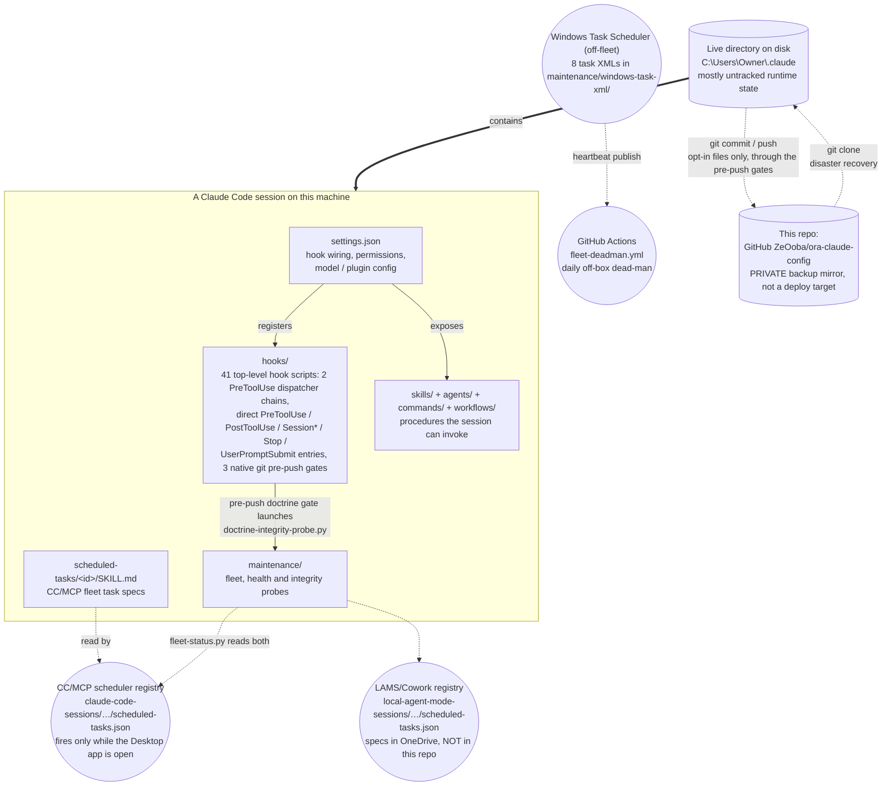
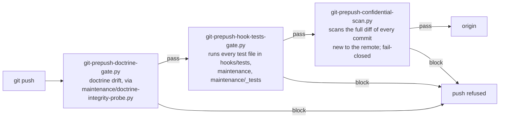
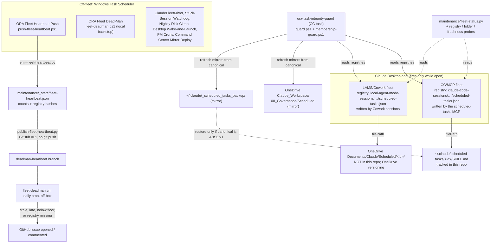
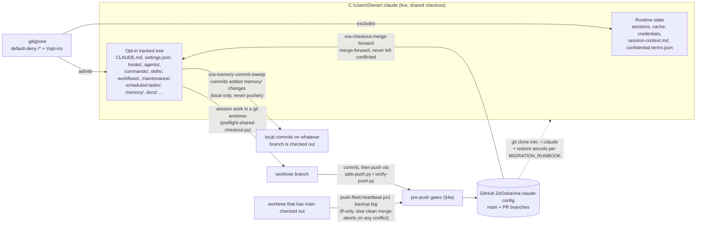

# ora-claude-config

**This is a config/backup repository, not an application.** It is the private GitHub
mirror (`ZeOoba/ora-claude-config`) of the `~/.claude` Claude Code configuration
directory that drives Oxford Realty Advisors' ("ORA") Claude Code automation — hooks,
skills, scheduled tasks, agents, commands, and workflows. It exists so that config,
skills, and hooks survive a lost/wiped machine, are diffable and code-reviewable like
any other source, and have a durable audit trail (git history) independent of the
live filesystem. Nothing here runs on its own — it is read and executed by Claude Code
itself (or by Windows Task Scheduler / GitHub Actions for the few off-fleet jobs noted
below) on the machine where `~/.claude` lives.

> Point-in-time doc, verified against `origin/main` on 2026-10-03; counts in §3 re-run on
> 2026-10-06 with `git ls-tree origin/main` at `11cce1d` (only the memory count had moved). Treat every count and path as directional:
> re-verify against `git ls-files`, `docs/system-inventory.md` (overwritten by
> `ora-weekly-hygiene` Block H — check its own "Generated" stamp before trusting it),
> and `python maintenance/fleet-status.py --summary` for live fleet state.

---

## 1. What this repo is

`~/.claude` on the operating machine (`C:\Users\Owner\.claude`) is simultaneously (a)
Claude Code's live working directory — where it reads config and writes session/runtime
state every time it runs — and (b) a git checkout of this repository. There is no
separate build/deploy step that produces one from the other. A `.gitignore` with a
**default-deny** policy (`/*` ignored, then explicit `!/path` opt-ins) decides which
top-level entries are versioned. Most of the directory is disposable runtime state that
never reaches GitHub (`cache/`, `sessions/`, `shell-snapshots/`, `worktrees/`,
`telemetry/`, `history.jsonl`, `.credentials.json`, `backups/`, `jobs/`, `daemon/`, …);
only named machinery — the actual configuration surface — is opted in and pushed.

The primary checkout is a **shared, single-writer** working tree that several concurrent
sessions write into, and it does not necessarily sit on `main`. Drift between it and
`origin/main` is detected by `maintenance/live-branch-drift-probe.py` /
`cross-repo-wip-scan.py` and reconciled by the `ora-checkout-merge-forward` scheduled task
(`maintenance/checkout-merge-forward.py`, which never leaves a conflicted state). Edits are
expected to happen in an isolated `git worktree`, gated by
`maintenance/preflight-shared-checkout.py`.

## 2. How the pieces relate

<!-- diagram-verified: 2026-10-28 -->

**Reading the diagram:** everything in the top box happens inside one live Claude Code
session. `settings.json` wires the hooks and exposes the skills/agents/commands/workflows
a session can call; the hooks then guard every tool call and lifecycle event that follows
(detail in §4a). `HOOKS -> MAINT` is load-bearing, not illustrative:
`hooks/git-prepush-doctrine-gate.py` launches `maintenance/doctrine-integrity-probe.py`
during the pre-push chain. `scheduled-tasks/*/SKILL.md` are the specs of the **CC/MCP**
fleet, read by the Claude Desktop scheduler (registry under `AppData/Roaming/Claude/` or
the packaged-app `LocalCache` mirror, located via `maintenance/_shared/scheduler-stores.json`);
the second, **LAMS/Cowork** fleet keeps its specs in OneDrive, outside this repo (§4b).
Windows Task Scheduler runs a handful of off-fleet jobs, and `fleet-deadman.yml` is the one
check that runs off this machine entirely. Cadences are deliberately not drawn: the live
registries are the authority. The live directory is upstream of GitHub — nothing deploys
*from* GitHub back into a running session automatically (§4c).

## 3. Directory structure

Verified against `git ls-files` at `origin/main` (2026-10-03; counts re-run 2026-10-06 at
`11cce1d`) and the files' own headers.

| Path | What it actually contains |
|---|---|
| `CLAUDE.md` | The global operating prompt (identity, hard invariants, routing canon, Engineering OS) loaded into every session. |
| `settings.json` | Hook wiring, permissions (`defaultMode: bypassPermissions`, with `allow`/`deny` lists), `env`, `model`, `statusLine`, `worktree`, `enabledPlugins` (`superpowers`, `pr-review-toolkit`), `extraKnownMarketplaces`, `skillOverrides`, and UI preferences. |
| `hooks/` | 41 top-level hook scripts (§4a), plus `lib/` (19 shared modules: commit/provenance parsing, override tokens, secret patterns, guard telemetry, session liveness, site/deploy tiers, …), `bin/netlify-guard-global.js` (machine-wide netlify CLI shim for Hard Invariant 2), `tests/` (61 `test-*.py` suites plus `tests/lib/`), and `archive/` (retired hook artifacts). `hooks/confidential-terms.json` (the confidential-deal roster) lives in this folder on disk but is **not tracked**. |
| `commands/` | 13 slash-command definitions — the Engineering-OS lanes (`build`, `debug`, `refactor`, `research`, `ship`, `plan`) and session utilities (`heavy`, `ram`, `solo`, `handoff`, `open-sessions`, `cleardisk`, `cleardisk-sessions`). |
| `agents/` | 17 custom sub-agent definitions (`adversarial-reviewer`, `comms-qc-reviewer`, `dd-package-sweep`, `deal-flow-triage`, `deal-recon`, `estoppel-reconciler`, `insurance-declaration-checker`, `lease-abstract-verifier`, `noi-opportunity-scout`, `open-items-triage`, `portfolio-anomaly-scout`, `psa-redline-checker`, `repro-isolator`, `security-auditor`, `site-qc-reviewer`, `tax-appeal-scout`, `underwriting-checker`). |
| `skills/` | 8 ORA-authored skills (`adversarial-merge-gate`, `branch-catchup`, `county-parcel-screen`, `county-sales-monitor`, `evidence-dossier-drafting`, `external-artifact-intake`, `ora-setup-audit`, `security-and-hardening`), some with `references/`, `scripts/` or `workflows/` subfolders, plus two `_archive_*` folders of retired skills. **Not** the full skill catalog — most `anthropic-skills:*` skills are Cowork-synced runtime content; ORA-built skill source lives in `ZeOoba/ora-skills`. |
| `maintenance/` | 91 top-level scripts/configs (Python probes, PowerShell engines, three onboarding `.cmd` launchers) and 96 `test-*`/`test_*` files across `maintenance/`, `_tests/`, `tests/` and `headless/`. Subfolders: `_shared/` (store discovery, fleet-pause helpers, acknowledgement allowlists, `scheduler-stores.json`), `_state/` (tracked probe state), `_applied/`, `_archive/`, `headless/` (Windows-Task-Scheduler twins of selected fleet checks, in parallel burn-in per `headless/CUTOVER.md`), `windows-task-xml/` (exported definitions of the 8 off-fleet Windows tasks). |
| `scheduled-tasks/` | One folder per CC/MCP task spec: 65 task folders, 28 dated `_archive_*` folders of retired/completed specs, one `_draft-*` folder, and `_shared/` (the Outlook COM send helper `send-via-outlook.ps1`, `outlook-sent-probe.ps1`, the double-fire `block-sentinel.py`, and their docs/tests). **Mostly** only `SKILL.md` is tracked; a short allow-list of task engines and references is also tracked (`ora-task-integrity-guard/guard.ps1` + `membership-guard.ps1`, `ora-pm-ledger/*_snapshot_diff.py` etc., `ora-appsec-sweep/suppressions.md`, `ora-renewal-hubspot-reconcile/read_rent_roll.py`). Runtime state, logs and `.bak` files are not. |
| `_scheduled_tasks_backup/` | A derived mirror of task `SKILL.md` specs (139 task folders + one archive folder), written by `scheduled-tasks/ora-task-integrity-guard/guard.ps1` (§4b). Canonical specs are authoritative; this mirror is used only to restore a canonical spec that has gone **absent**. |
| `workflows/` | 3 multi-agent `Workflow` scripts (`cc-audit-army.js`, `cc-eval-plan-premortem.js`, `verified-deal-recon.js`), `README-cc-self-audit.md`, and a `_tests/` prompt-snapshot rig. |
| `mcp-servers/` | 2 self-authored, single-file, read-only MCP servers: `fred/` (St. Louis Fed FRED API) and `census/` (U.S. Census Bureau Data API). |
| `obsidian-fleet-mirror/` | Scripts that render live fleet state into the Obsidian vault (`write-fleet.ps1`, run every 60 s by the `ClaudeFleetMirror` Windows task via `run-hidden.vbs`); the rendered state files are untracked. |
| `prompts/` | Standing prompt templates for recurring autonomous runs, their extract/verify helpers, and an `_archive/`. |
| `docs/` | `system-inventory.md` (weekly overwrite snapshot), `MIGRATION_RUNBOOK.md` (cold-start/restore), `diagrams/` (six standalone Mermaid `.mmd` detail diagrams, §4), `authority-registry.md`, `review-lenses.md`, dated build reports/specs, `plans/`, `agent-references/`, and `superpowers/` (8 design specs + 19 implementation plans for the Engineering-OS and remediation work). |
| `.github/workflows/` | 2 workflows: `fleet-deadman.yml` (scheduled off-box dead-man, §4b) and `claude-ci-fix.yml` (event-driven auto-fix responder on failed PR checks, change-requested reviews, or `@claude` / CodeRabbit comments; `@claude` fires only for the repo owner, actions are SHA-pinned, and the workflow token is `contents: read` — pushes use the Claude GitHub App token). |
| `projects/…/memory/` | The ORA memory system — only `projects/C--Users-Owner-OneDrive---Oxford-Capital-Partners/memory/` is tracked (421 files at 2026-10-06 and growing daily: `MEMORY.md` index, `event_log.md`, `open-items-tracker.md`, dated feedback/project/reference notes). Session transcripts (`.jsonl`) are **not** tracked. |
| `_archive/` | Superseded config, a retired plugin bundle, pre-trim snapshots, and the applied hooks-audit `settings.json` proposal (`2026-10-18_settings-proposed-fold/`, formerly `_proposed/`) — files are moved here rather than deleted. |
| `confidential-repos.json` | A small roster naming which *other* ORA repos require confidentiality gating on code-review tooling, plus the rule text — see §5; contents not enumerated here. |
| `keybindings.json`, `.gitattributes`, `daily-setup-audit-prompt.md` | Small standalone config/reference files, individually opted in. |

Everything else on disk (`cache/`, `sessions/`, `worktrees/`, `telemetry/`,
`.credentials.json`, `backups/`, `jobs/`, `daemon/`, `shell-snapshots/`, `session-env/`,
`session-context.md`, `handoffs/`, `plans/`, `tasks/`, `ide/`, `paste-cache/`,
`artifacts/`, `downloads/`, `history.jsonl`, …) is intentionally absent from GitHub —
secret, machine-specific, confidential, or freely regenerable.

## 4. Architecture

The inline diagrams below are the overview. Six standalone detail diagrams (verified
2026-10-06, each citing its source `file:line` in a `%%` header) live in `docs/diagrams/`:

| File | Covers |
|---|---|
| `01_hook_lifecycle.mmd` | All six hook events, dispatcher internals (fail-closed on a missing guard, in-process then subprocess fallback, telemetry), direct matchers incl. `workbook-write-guard`, PostToolUse marker stores; `posttooluse-dispatcher` shown as unwired |
| `02_prepush_gates.mmd` | Untracked pre-push shim, push callers, per-gate override-ability / fail-closed; no test workflow in Actions |
| `03_claim_preflight_flow.mmd` | Preflight verdicts and exit codes, claim TTLs, the two claim stores, claim-lock, release |
| `04_scheduled_fleets.mmd` | Both fleets, task-output sinks, heartbeat/dead-man chain, `system-inventory.md` freshness |
| `05_event_log_memory_writers.mmd` | Event-log appender (spool / in-place fallback), rollover, memory direct edits, commit sweep, OI allocator |
| `06_backup_and_landing.mmd` | Worktree landing, backup leg, merge-forward refusal conditions, missing offsite copy of untracked state |

### 4a. Hook gate chain

`settings.json` wires hooks on six events. The PreToolUse layer is consolidated into
`hooks/pretooluse-dispatcher.py`, which runs two **separate** ordered chains in one
process: the default chain for `Edit|Write|MultiEdit`, and `--chain bash` for `Bash`.
Tools outside those matchers (NotebookEdit, Desktop Commander writes, Excel, Outlook/Teams/
Notion/SharePoint/HubSpot write tools, the scheduled-tasks MCP) are covered by direct
`settings.json` entries instead.

```mermaid
flowchart LR
    CALL["Tool call"] --> M{"settings.json<br/>PreToolUse matcher"}
    M -->|"Edit / Write / MultiEdit"| DEW["pretooluse-dispatcher.py<br/>(default chain)"]
    M -->|"Bash"| DB["pretooluse-dispatcher.py<br/>--chain bash"]
    M -->|"NotebookEdit, MCP write tools"| DIRECT["Direct entries:<br/>ora-autonomy-gate, confidentiality-guard,<br/>config-write-guard, lint-config-guard,<br/>workbook-write-guard, registry-write-guard,<br/>memory-index-guard, ascii-only-guard,<br/>mcp-delete-guard, sensitive-file-guard,<br/>scheduled-task-update-preguard"]
    M -->|"Edit / Write"| INLINE["Inline sensitive-file blocker<br/>(credentials / .env / password paths)"]

    subgraph EW["Edit/Write chain (in order)"]
        direction TB
        E1["ora-autonomy-gate"] --> E2["confidentiality-guard"] --> E3["eos-plan-gate"] --> E4["shared-checkout-guard"] --> E5["registry-write-guard"] --> E6["config-write-guard"] --> E7["eos-claude-md-guard"] --> E8["memory-index-guard"] --> E9["rules-md-guard"] --> E10["lint-config-guard"] --> E11["sensitive-file-guard"] --> E12["ascii-only-guard"]
    end

    subgraph BC["Bash chain (in order)"]
        direction TB
        B1["ora-autonomy-gate"] --> B2["confidentiality-guard"] --> B3["config-write-guard"] --> B4["lint-config-guard"] --> B5["workbook-write-guard"] --> B6["eos-evidence-gate"] --> B7["eos-review-gate"] --> B8["commit-provenance-guard"] --> B9["worktree-isolation-guard"] --> B10["destructive-git-guard"] --> B11["memory-orphan-link-guard"] --> B12["commit-hygiene-guard"] --> B13["winpath-guard"] --> B14["pipe-mask-guard"]
    end

    DEW --> E1
    DB --> B1
    E11 --> RES{"Any guard exit 2?"}
    B12 --> RES
    DIRECT --> RES
    INLINE --> RES
    RES -->|"yes: first block wins,<br/>chain short-circuits"| BLOCK["Tool call refused"]
    RES -->|"no"| RUN["Tool runs, then PostToolUse hooks"]
```

<!-- diagram-verified: 2026-10-28 -->

Dispatcher semantics (from its own header): guard order is load-bearing and mirrors
`settings.json`; each guard runs in-process and, if it cannot load or raises, is re-run as
a subprocess; the first exit 2 blocks and short-circuits; a guard script **missing** from
disk fails the whole chain **closed**; malformed input is passed through so each guard
applies its own policy (`confidentiality-guard.py` fails closed by design). Per-guard
telemetry goes to `hooks/_state/guard-telemetry.jsonl` (no command text or paths), read
with `hooks/guard-telemetry-summary.py`. `python hooks/pretooluse-dispatcher.py --selfcheck`
verifies both chains.

| Hook | Event / wiring | Purpose (from the file header) |
|---|---|---|
| `ora-autonomy-gate` | PreToolUse (both chains + direct) | Preserves the human gates for external sends and oxfordra.net deploys under `bypassPermissions`. |
| `confidentiality-guard` | PreToolUse (both chains + direct) | Fail-closed egress guard against confidential deal identifiers in outbound tools. |
| `config-write-guard` | PreToolUse (both chains + direct) | Hard write-gate on the governance layer (hooks, settings, CLAUDE.md, etc.) plus claim-lock. |
| `lint-config-guard` | PreToolUse (both chains + direct) | Fail-closed guard on edits to existing oxford-command-center lint/format/typecheck configs. |
| `workbook-write-guard` | PreToolUse (Bash chain + direct) | Write-gate on the ORA Master Workbook. |
| `registry-write-guard` | PreToolUse (Edit/Write chain + Desktop Commander) | Blocks hand-edits of scheduled-task registry JSON. |
| `memory-index-guard` | PreToolUse (Edit/Write chain + Desktop Commander) | Write-time checks on the `MEMORY.md` index. |
| `eos-plan-gate`, `eos-claude-md-guard`, `rules-md-guard`, `shared-checkout-guard`, `ascii-only-guard` | PreToolUse (Edit/Write chain) | Plan-before-sprawl gate; CLAUDE.md doctrine guard; `rules.md` dated-header guard; shared-checkout warning; ASCII-only rail for declared files. |
| `eos-evidence-gate`, `eos-review-gate`, `commit-provenance-guard`, `worktree-isolation-guard`, `destructive-git-guard`, `memory-orphan-link-guard`, `commit-hygiene-guard` | PreToolUse (Bash chain) | Commit-time gates: evidence (non-blocking), review for blast-radius/financial code, no sweeping another live session's WIP, blast-radius commits must come from a worktree, no discarding uncommitted work, no orphan memory-index links, commit hygiene (warn-only). |
| `scheduled-task-update-preguard` / `-postguard` | Pre/PostToolUse on `update_scheduled_task` | Hand-edit warning; dropped-frontmatter-key warning. |
| `commit-provenance-recorder`, `memory-nag-correction`, `eos-plan-marker`, `eos-gate-sentinel`, `fleet-session-hook` | PostToolUse | Records which session wrote which file; memory-index nag correction; plan marker; test-ran marker; Obsidian live-activity mirror. |
| `engineering-router` | UserPromptSubmit | Non-blocking Engineering-OS lane suggester. |
| `repo-freshness`, `active-work-broadcast`, `fleet-session-hook` | SessionStart | oxford-command-center freshness; broadcast live cross-session claims; activity mirror. (SessionStart also `cat`s the untracked `session-context.md`.) |
| `fleet-session-hook`, `eos-telemetry` | Stop / SessionEnd | Activity mirror; reliability telemetry. |
| `git-prepush-doctrine-gate`, `git-prepush-hook-tests-gate`, `git-prepush-confidential-scan` | Native git `pre-push` (not `settings.json`) | See below. |
| `posttooluse-dispatcher` | PostToolUse (Bash, timeout 360) | Single Bash PostToolUse entry; runs `eos-gate-sentinel` and `ora-skills/tools/catch_up_main.py --hook` (the latter only on `gh pr merge`), each under its original matcher, with `chain: "post"` guard telemetry. |

The former inline oxfordra.net post-deploy HTTP check and inline Netlify-MCP post-call
check were removed when the hooks-audit proposal was applied (see
`_archive/2026-10-18_settings-proposed-fold/APPLY.md`).

**Pre-push chain.** A native `.git/hooks/pre-push` shim (untracked; clones do not carry
`.git/hooks` — re-install per each gate's header and `docs/MIGRATION_RUNBOOK.md`) runs
three gates in order:

<!-- diagram-verified: 2026-10-03 -->

The confidentiality scan covers the commit range being pushed (remote ref..local, or
`origin/<default>..local` for a brand-new branch) — not the whole history on every push —
and reports deal-relative indices only, never the terms. The `ora-prepush-gate-sweep`
scheduled task runs the same three gates weekly without pushing.

### 4b. Dual scheduled-task fleet

Two scheduler registries are live, both fired by the Claude Desktop app and only while it
is open. `maintenance/fleet-status.py` reads both and tags each task by fleet; store roots
and ratified fleet floors are single-sourced in `maintenance/_shared/scheduler-stores.json`.
Tasks are registered only through the supervised `create_scheduled_task` /
`update_scheduled_task` MCP tools — `hooks/registry-write-guard.py` blocks registry JSON
hand-edits.

<!-- diagram-verified: 2026-10-03 -->

`guard.ps1`'s write policy (from its header): canonical specs are authoritative, the two
mirrors are derived, canonical is written **only when absent**, nothing is deleted, and
content identity is a CR-normalized SHA-256 (never mtime). Scheduled-task email goes out
only through the Outlook COM helper in `scheduled-tasks/_shared/send-via-outlook.ps1`,
under the routing canon in `CLAUDE.md`. Selected checks are also being run as headless
Windows tasks in parallel burn-in (`maintenance/headless/CUTOVER.md`); none of the in-fleet
twins is retired.

### 4c. Repo layout and backup flow

<!-- diagram-verified: 2026-10-03 -->

Nothing deploys from GitHub into a running session: a clone only becomes "live" when it
is placed at `~/.claude` and Claude Code is pointed at it. Before a new top-level directory
is opted in, `maintenance/scrub-before-optin.py` checks it; `doctrine-integrity-probe.py`
surfaces untracked backup-coverage gaps, and
`maintenance/task-folder-backup-completeness-probe.py` flags substantive files inside
CC/MCP task folders that `.gitignore` would silently hide.

## 5. What this repo is NOT

- **Not runnable software.** There is no build step and no deployable service. The
  `.py`/`.js`/`.ps1` files are hooks, probes, engines and workflow scripts that only act
  when Claude Code, Windows Task Scheduler, or a `.cmd` launcher invokes them on the
  machine where `~/.claude` lives.
- **Not a source-to-deploy pipeline.** The two GitHub workflows monitor the fleet
  heartbeat and respond to PR review/CI events; neither builds or ships a product.
- **How it is actually used:** cloned to (or already living at) `~/.claude` — on Windows
  specifically `C:\Users\Owner\.claude`, since hook paths in `settings.json` are hardcoded
  to that profile and interpreter. Restoring a machine means `git clone` into that path,
  re-installing the native pre-push shim, then separately recovering the secrets and live
  state this repo deliberately excludes (`.credentials.json`, `hooks/confidential-terms.json`,
  the out-of-repo secret files and environment variables the runbook lists, the live
  scheduler registries, `session-context.md`) — see
  `docs/MIGRATION_RUNBOOK.md`. Verify health with
  `python maintenance/fleet-status.py --summary`, `doctrine-integrity-probe.py`,
  `governor-drift-probe.py` and `python hooks/pretooluse-dispatcher.py --selfcheck`.

## 6. Confidentiality note

This is a **PRIVATE** GitHub repository (`ZeOoba/ora-claude-config`). Even so:

- **`confidential-repos.json`** — a roster of other repos that require confidentiality
  gating (e.g. blocking certain cloud code-review tooling on them). Its contents are not
  enumerated in this README by design.
- **`hooks/confidential-terms.json`** — the live roster of active confidential deal
  terms. It resides in `hooks/` on disk but is git-ignored; it never reaches this repo's
  history. Tests that need it declare `CANNOT RUN:` (an ENV-SKIP, not a failure) in a
  worktree where it is absent.
- **`session-context.md`** — the other home of that roster; untracked by design and
  backed up only locally, scrubbed, by `maintenance/backup-session-context.py`.
- Every push is scanned by `hooks/git-prepush-confidential-scan.py` across the full diff
  of every commit new to the remote, fail-closed, before anything leaves the machine.
- Deal-specific content, tenant PII, and credentials are never described in specifics in
  this repo's documentation (including this README) — only by reference to the file or
  mechanism that holds them.

---

## 7. Known caveats

- The live checkout routinely carries uncommitted changes from other in-flight sessions
  (task-spec mirrors, memory appends, probe state). That is normal fleet churn, not drift
  to fix. Confirm a file is yours before committing it (the provenance hooks enforce this),
  and edit in an isolated worktree.
- `skills/` here is intentionally small (8 skills). Do not treat it as the full catalog;
  cross-check `docs/system-inventory.md` and `ZeOoba/ora-skills`.
- Live task counts, crons and enablement are never hand-maintained here; read the
  registries via `fleet-status.py`. `docs/system-inventory.md` is only as current as its
  last `ora-weekly-hygiene` run.
- The fleet-floor tripwires live in one place: `maintenance/_shared/scheduler-stores.json`
  (`fleetFloors`). `fleet-deadman.yml` reads them from there at run time (since 2026-11-05)
  and fails closed if it cannot; `maintenance/test-fleet-deadman-workflow.py` pins that
  parity. Its alarms open one GitHub issue per failure class (`FLEET DEAD-MAN [<class>]: ...`).
- The permission posture is deliberate, not an oversight. `settings.json` runs
  `defaultMode: bypassPermissions` with `skipDangerousModePermissionPrompt`, so the `allow`
  list is not an effective gate (it mostly documents intent). The real controls are the
  `deny` list (destructive shell and PowerShell patterns, force-push, `reset --hard`, the
  Netlify updater MCP tools), the PreToolUse hook chains in section 4a (notably
  `ora-autonomy-gate`, which keeps the human gates for external sends and oxfordra.net
  deploys), and the hard invariants in `CLAUDE.md`. `deny` rules and hooks only cover what
  they pattern-match, so when adding a risky capability add a `deny` pattern or a guard
  hook, never just an `allow` entry. Deny rules bind Claude's own tool calls, not scripts
  that hooks or scheduled tasks run.

---

*This README is itself an opt-in (`.gitignore` `!/README.md`) — if it stops appearing
on GitHub after a `.gitignore` edit, that opt-in was the thing that broke. Its
`diagram-verified` stamps are checked by `maintenance/diagram-freshness-probe.py`.*
