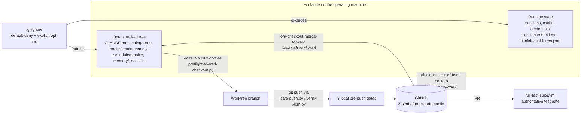
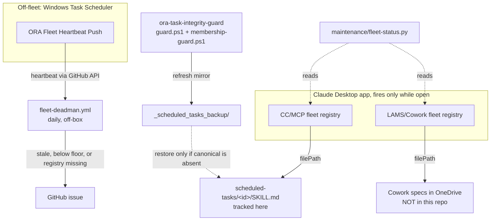
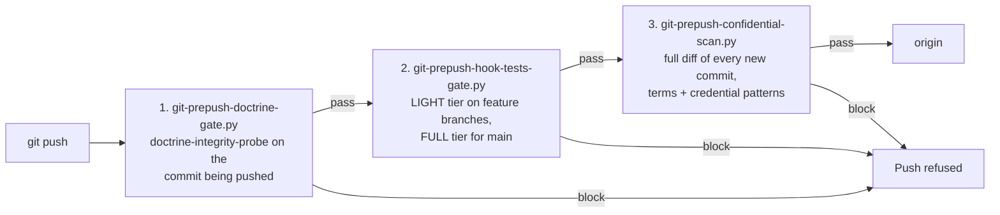

# ora-claude-config

> Version-controlled backup of the `~/.claude` Claude Code configuration that runs Oxford Realty Advisors' (ORA) automation: hook guards, maintenance probes, scheduled-task specs, agents, commands, skills, workflows and the memory system.

**This is a config backup, not an application.** Nothing here builds, ships or deploys. The
files are read and executed by Claude Code itself (and, for a few off-fleet jobs, by Windows
Task Scheduler and GitHub Actions) on the machine where `~/.claude` lives. The repo exists so
that the configuration survives a lost machine, can be diffed and code-reviewed like source,
and has an audit trail in git history that does not depend on the live filesystem.

> [!NOTE]
> **Point-in-time document.** Every count and path below was verified with `git ls-files`
> against `origin/main` at `6865c3c0` on **2026-11-10**. Treat counts as directional and
> re-verify before relying on one: `git ls-files`, [`docs/system-inventory.md`](docs/system-inventory.md)
> (weekly overwrite; check its "Generated" stamp), and `python maintenance/fleet-status.py --summary`
> for live fleet state.

> [!IMPORTANT]
> **This repository is public.** Anything committed here is world-readable, including history.
> See [Backup scope and the opt-in model](#backup-scope-and-the-opt-in-model) and
> [Confidentiality](#confidentiality) before opting in a new path.

---

## Contents

- [What this repo is](#what-this-repo-is)
- [Architecture](#architecture)
  - [Guard pipeline](#guard-pipeline)
  - [Backup flow](#backup-flow)
  - [Detail diagrams](#detail-diagrams)
- [Repository layout](#repository-layout)
- [Hooks and guards reference](#hooks-and-guards-reference)
- [Maintenance and scheduled tasks](#maintenance-and-scheduled-tasks)
- [Backup scope and the opt-in model](#backup-scope-and-the-opt-in-model)
- [Pre-push gates and CI](#pre-push-gates-and-ci)
- [Restoring on a new machine](#restoring-on-a-new-machine)
- [Conventions](#conventions)
- [Confidentiality](#confidentiality)
- [Known caveats](#known-caveats)
- [Further documentation](#further-documentation)

---

## What this repo is

`~/.claude` on the operating machine is two things at once:

1. **Claude Code's live working directory**, where it reads config and writes session and
   runtime state on every run; and
2. **a git checkout of this repository.**

There is no build step between the two. A **default-deny** `.gitignore` (`/*` ignored, then
explicit `!/path` opt-ins) decides which entries are versioned. Most of the directory is
runtime state that never reaches GitHub (`cache/`, `sessions/`, `shell-snapshots/`,
`worktrees/`, `telemetry/`, `history.jsonl`, `.credentials.json`, `backups/`, `jobs/`, ...).
Only named configuration machinery is opted in.

The primary checkout is a **shared, single-writer** tree that several concurrent sessions
write into, and it is not necessarily on `main`. Edits are expected to happen in an isolated
`git worktree`, gated by `maintenance/preflight-shared-checkout.py`. Drift between the live
checkout and `origin/main` is detected by `maintenance/live-branch-drift-probe.py` and
`maintenance/cross-repo-wip-scan.py`, and reconciled by the `ora-checkout-merge-forward`
scheduled task (`maintenance/checkout-merge-forward.py`, which never leaves a conflicted tree).

| This repo **is** | This repo **is not** |
|---|---|
| A durable, reviewable backup of hooks, probes, specs and memory | Runnable or deployable software |
| The source the live `~/.claude` checkout merges forward from | A deploy pipeline: nothing flows from GitHub into a running session automatically |
| Guarded by three local pre-push gates plus a CI test suite | The full skill catalog (most skills live in `ZeOoba/ora-skills` or are Cowork-synced) |

---

## Architecture

### Guard pipeline

`settings.json` wires hooks on six events (`UserPromptSubmit`, `PreToolUse`, `PostToolUse`,
`SessionStart`, `Stop`, `SessionEnd`), 31 hook entries in all. The entries are rendered from a
single table, [`hooks/wiring/settings-wiring.toml`](hooks/wiring/settings-wiring.toml), and
`python maintenance/render-settings-wiring.py --check` fails on any difference.

The PreToolUse layer is consolidated into `hooks/pretooluse-dispatcher.py`, which runs one of
two **separate, ordered** chains in a single process: the default `editwrite` chain for
`Edit|Write|MultiEdit`, and `--chain bash` for `Bash`. Tools outside those matchers
(NotebookEdit, PowerShell, Desktop Commander, Excel, Outlook/Teams/Notion/SharePoint/HubSpot
write tools, MCP delete-shaped tools, the scheduled-tasks MCP) are covered by direct
`settings.json` entries instead.

```mermaid
flowchart LR
    CALL["Tool call"] --> M{"settings.json<br/>PreToolUse matcher"}
    M -->|"Edit / Write / MultiEdit"| DEW["pretooluse-dispatcher.py<br/>editwrite chain, 13 guards"]
    M -->|"Bash"| DB["pretooluse-dispatcher.py<br/>--chain bash, 16 guards"]
    M -->|"Edit / Write"| INLINE["Inline sensitive-file blocker<br/>credentials / .env paths"]
    M -->|"NotebookEdit, PowerShell,<br/>MCP write and delete tools"| DIRECT["Direct entries<br/>autonomy, confidentiality, config, lint,<br/>workbook, registry, memory-index, ascii,<br/>override-mint, sensitive-file, mcp-delete,<br/>scheduled-task preguard"]

    subgraph EW["editwrite chain, in order"]
        direction TB
        E1["ora-autonomy-gate"] --> E2["confidentiality-guard"] --> E3["eos-plan-gate"] --> E4["shared-checkout-guard"] --> E5["registry-write-guard"] --> E6["config-write-guard"] --> E7["eos-claude-md-guard"] --> E8["memory-index-guard"] --> E9["rules-md-guard"] --> E10["lint-config-guard"] --> E11["sensitive-file-guard"] --> E12["override-mint-guard"] --> E13["ascii-only-guard"]
    end

    subgraph BC["bash chain, in order"]
        direction TB
        B1["ora-autonomy-gate"] --> B2["confidentiality-guard"] --> B3["config-write-guard"] --> B4["lint-config-guard"] --> B5["workbook-write-guard"] --> B6["eos-evidence-gate"] --> B7["eos-review-gate"] --> B8["commit-provenance-guard"] --> B9["worktree-isolation-guard"] --> B10["destructive-git-guard"] --> B11["memory-orphan-link-guard"] --> B12["commit-hygiene-guard"] --> B13["override-mint-guard"] --> B14["winpath-guard"] --> B15["rewrite-advisory-guard"] --> B16["pipe-mask-guard"]
    end

    DEW --> E1
    DB --> B1
    E13 --> RES{"Any guard<br/>exit 2 or deny?"}
    B16 --> RES
    DIRECT --> RES
    INLINE --> RES
    RES -->|"yes: first block wins,<br/>chain short-circuits"| BLOCK["Tool call refused"]
    RES -->|"no"| RUN["Tool runs, then PostToolUse hooks"]
```


<!-- diagram-verified: 2026-11-10 -->

**Dispatcher semantics** (from the dispatcher's own header):

- Guard order is load-bearing and is mirrored in `hooks/wiring/settings-wiring.toml`.
- Each guard runs in-process; if it cannot load or raises, it is re-run as a subprocess.
- The first exit 2 blocks and short-circuits the chain.
- A guard script **missing** from disk fails the whole chain **closed**; an unknown `--chain`
  name also blocks rather than guessing.
- `permissionDecision` outputs are merged by severity (deny > ask > allow), not by arrival order.
- `pipe-mask-guard` must stay last in the bash chain: it is the only guard that emits a command
  rewrite, and only a chain that reached the end unblocked may emit one.
- Per-guard telemetry goes to `hooks/_state/guard-telemetry.jsonl` (no command text or paths;
  kill switch `ORA_GUARD_TELEMETRY=0`), summarised by `hooks/guard-telemetry-summary.py`.

Verify both chains at any time:

```sh
python hooks/pretooluse-dispatcher.py --selfcheck        # every guard file present, prints order
python maintenance/render-settings-wiring.py --check     # settings.json matches the wiring table
```

### Backup flow


<!-- diagram-verified: 2026-11-10 -->

Settled memory changes are committed locally by the `ora-memory-commit-sweep` task (it never
pushes); the heartbeat push job carries a backup leg that pushes `main` (fast-forward only,
else a clean merge, aborting on any conflict). Both still pass through the pre-push gates.

### Detail diagrams

Six standalone Mermaid diagrams, each citing its sources in a `%%` header, live in
[`docs/diagrams/`](docs/diagrams/):

| File | Covers |
|---|---|
| [`01_hook_lifecycle.mmd`](docs/diagrams/01_hook_lifecycle.mmd) | All six hook events, dispatcher internals, direct matchers, PostToolUse marker stores |
| [`02_prepush_gates.mmd`](docs/diagrams/02_prepush_gates.mmd) | Untracked pre-push shim, push callers, per-gate override and fail-closed behaviour |
| [`03_claim_preflight_flow.mmd`](docs/diagrams/03_claim_preflight_flow.mmd) | Preflight verdicts and exit codes, claim TTLs, claim stores, release |
| [`04_scheduled_fleets.mmd`](docs/diagrams/04_scheduled_fleets.mmd) | Both scheduler fleets, output sinks, heartbeat / dead-man chain |
| [`05_event_log_memory_writers.mmd`](docs/diagrams/05_event_log_memory_writers.mmd) | Event-log appender, rollover, memory edits, commit sweep, open-item allocator |
| [`06_backup_and_landing.mmd`](docs/diagrams/06_backup_and_landing.mmd) | Worktree landing, backup leg, merge-forward refusal conditions |

---

## Repository layout

Tracked-file counts from `git ls-files` on **2026-11-10** (1,654 tracked files in total).

| Path | Purpose | Tracked files |
|---|---|---:|
| `CLAUDE.md` | Global operating prompt loaded into every session (identity, invariants, routing, Engineering OS) | 1 |
| `settings.json` | Hook wiring, permissions (`allow` / `deny`, `defaultMode`), env, model, status line, plugins, skill overrides | 1 |
| [`hooks/`](hooks/) | 42 hook scripts + `mcp-delete-allowlist.json`; `lib/` (24 shared modules), `tests/` (75 test files + 7 test-lib files), `wiring/settings-wiring.toml`, `bin/netlify-guard-global.js` (machine-wide Netlify CLI shim), `archive/` | ~155 |
| [`maintenance/`](maintenance/) | 105 top-level probes, engines and launchers (82 `.py`, 16 `.ps1`, 3 onboarding `.cmd`, misc) + 56 top-level tests; `_shared/`, `_state/`, `_tests/`, `headless/`, `ora-live/`, `windows-task-xml/` (8 task exports), `_applied/`, `_archive/` (243) | ~545 |
| [`scheduled-tasks/`](scheduled-tasks/) | CC/MCP fleet specs: 71 active task folders (`SKILL.md` + a short per-file allow-list of engines), 28 `_archive_*` folders, 1 `_draft-*`, `_shared/` (Outlook COM send path, double-fire sentinel, send-contract tests) | ~186 |
| `_scheduled_tasks_backup/` | Derived mirror of task specs (139 task folders + 1 archive) written by `ora-task-integrity-guard`; used only to restore a canonical spec that has gone absent | ~147 |
| `projects/<workspace>/memory/` | The ORA memory system: `MEMORY.md` index, `event_log.md`, open-items tracker, dated feedback / project / reference notes. Only this one project's `memory/` is tracked; transcripts are not | ~432 |
| [`docs/`](docs/) | Runbook, system inventory, authority registry, review lenses, `diagrams/`, `superpowers/` (9 specs, 24 plans), dated build reports | ~49 |
| [`agents/`](agents/) | Custom sub-agent definitions | 22 |
| [`commands/`](commands/) | Slash commands: Engineering-OS lanes and session utilities | 13 |
| [`skills/`](skills/) | 9 ORA-authored skills + 2 `_archive_*` folders (not the full catalog) | ~51 |
| [`workflows/`](workflows/) | 3 multi-agent Workflow scripts + `_tests/` prompt-snapshot rig | 10 |
| [`prompts/`](prompts/) | Standing prompt templates, extract/verify helpers, `_archive/` | 9 |
| [`.github/workflows/`](.github/workflows/) | `full-test-suite.yml`, `fleet-deadman.yml`, `claude-ci-fix.yml` | 3 |
| [`mcp-servers/`](mcp-servers/) | Two single-file, read-only MCP servers: `fred/` and `census/` | 2 |
| [`obsidian-fleet-mirror/`](obsidian-fleet-mirror/) | Renders live fleet state into the Obsidian vault (scripts only; rendered state untracked) | 4 |
| `_archive/` | Superseded config and applied proposals; files are moved here rather than deleted | ~18 |
| Root files | `.gitignore`, `.gitattributes`, `README.md`, `confidential-repos.json`, `keybindings.json`, `daily-setup-audit-prompt.md` | 6 |

<details>
<summary><strong>Agents (22)</strong></summary>

`adversarial-reviewer`, `comms-qc-reviewer`, `dd-package-sweep`, `deal-flow-triage`,
`deal-recon`, `estoppel-reconciler`, `insurance-declaration-checker`,
`lease-abstract-verifier`, `listing-channel-scout`, `listing-poster`,
`listing-syndication-auditor`, `mfg-investment-scout`, `noi-opportunity-scout`,
`open-items-triage`, `portfolio-anomaly-scout`, `psa-redline-checker`, `repro-isolator`,
`security-auditor`, `site-qc-reviewer`, `tax-appeal-scout`, `underwriting-checker`,
`vacancy-listing-packager`.

</details>

<details>
<summary><strong>Commands (13) and skills (9)</strong></summary>

**Commands.** Engineering-OS lanes: `build`, `debug`, `refactor`, `research`, `ship`, `plan`.
Session utilities: `heavy`, `ram`, `solo`, `handoff`, `open-sessions`, `cleardisk`,
`cleardisk-sessions`.

**Skills.** `adversarial-merge-gate`, `branch-catchup`, `county-parcel-screen`,
`county-sales-monitor`, `evidence-dossier-drafting`, `external-artifact-intake`,
`ora-setup-audit`, `security-and-hardening`, `xlsx-warehouse-importer`. ORA-built skill source
otherwise lives in `ZeOoba/ora-skills`.

**Workflows.** `cc-audit-army.js`, `cc-eval-plan-premortem.js`, `verified-deal-recon.js`
(see [`workflows/README-cc-self-audit.md`](workflows/README-cc-self-audit.md)).

</details>

---

## Hooks and guards reference

42 Python hook scripts live at the top of `hooks/`. Guard posture is stated in each file's
header; most guards **fail open** on internal error (a bug must never brick tool use), while
the egress and governance gates noted below **fail closed**.

| Group | Hooks | Wiring | Posture |
|---|---|---|---|
| Dispatchers | `pretooluse-dispatcher`, `posttooluse-dispatcher` | PreToolUse (Edit/Write, Bash); PostToolUse (Bash) | Missing guard file fails closed |
| Egress and safety | `ora-autonomy-gate`, `confidentiality-guard`, `sensitive-file-guard`, `override-mint-guard`, `mcp-delete-guard` | Both chains and direct entries | Autonomy and confidentiality gates fail closed |
| Governance write gates | `config-write-guard`, `registry-write-guard`, `lint-config-guard`, `workbook-write-guard`, `eos-claude-md-guard`, `rules-md-guard`, `memory-index-guard`, `scheduled-task-update-preguard`, `scheduled-task-update-postguard` | Chains and direct entries | Mixed; see headers |
| Commit-time and Engineering OS | `eos-plan-gate`, `eos-evidence-gate`, `eos-review-gate`, `commit-provenance-guard`, `worktree-isolation-guard`, `destructive-git-guard`, `memory-orphan-link-guard`, `commit-hygiene-guard`, `shared-checkout-guard` | Mostly the bash chain | Review gate fails closed; evidence, hygiene and shared-checkout are warn-only |
| Shell hygiene | `winpath-guard`, `rewrite-advisory-guard`, `pipe-mask-guard`, `ascii-only-guard` | Bash chain; ASCII rail on Edit/Write and Desktop Commander | Advisory guard never blocks; pipe-mask rewrites |
| Lifecycle and markers | `commit-provenance-recorder`, `memory-nag-correction`, `eos-plan-marker`, `eos-gate-sentinel`, `fleet-session-hook`, `engineering-router`, `repo-freshness`, `active-work-broadcast`, `eos-telemetry` | PostToolUse, UserPromptSubmit, SessionStart, Stop, SessionEnd | Non-blocking |
| Pre-push gates | `git-prepush-doctrine-gate`, `git-prepush-hook-tests-gate`, `git-prepush-confidential-scan` | Native git `pre-push` shim, not `settings.json` | Fail closed |
| Utility | `guard-telemetry-summary` | Run by hand | Read-only |

<details>
<summary><strong>Per-hook detail</strong></summary>

| Hook | What it does (from the file header) |
|---|---|
| `ora-autonomy-gate` | Preserves the human gates for external sends and production site deploys under `bypassPermissions` |
| `confidentiality-guard` | Fail-closed egress guard against confidential deal identifiers in outbound tools |
| `sensitive-file-guard` | Python port of the inline `.env` / credentials blocker |
| `override-mint-guard` | Blocks override-token writes from scheduled or headless sessions |
| `mcp-delete-guard` | Stands in for the missing permission prompt on delete-shaped MCP tools (allow-list in `mcp-delete-allowlist.json`) |
| `config-write-guard` | Write gate on the governance layer (hooks, settings, `CLAUDE.md`, ...) plus claim-lock |
| `registry-write-guard` | Blocks hand edits of scheduled-task registry JSON |
| `lint-config-guard` | Guards edits to existing lint / format / typecheck configs in a sibling repo |
| `workbook-write-guard` | Write gate on the master workbook |
| `eos-claude-md-guard`, `rules-md-guard`, `memory-index-guard` | Doctrine-file guards: `CLAUDE.md`, `rules.md` dated headers, `MEMORY.md` index |
| `scheduled-task-update-preguard` / `-postguard` | Hand-edit warning and dropped-frontmatter-key warning on `update_scheduled_task` |
| `eos-plan-gate` | Denies the 4th+ code edit in a session with no plan marker |
| `eos-evidence-gate` | Pre-commit reminder when no test or gate ran this session (never blocks) |
| `eos-review-gate` | Requires a recorded review for blast-radius and financial code |
| `commit-provenance-guard` | Stops a commit from sweeping another live session's work |
| `worktree-isolation-guard` | Blast-radius commits must come from a worktree |
| `destructive-git-guard` | Blocks `checkout --`, `reset --hard`, `clean -f` only when they would discard uncommitted work |
| `memory-orphan-link-guard` | No orphan links into the memory index |
| `commit-hygiene-guard` | Two commit-time hygiene checks (warn-only) |
| `shared-checkout-guard` | Warns on edits into a dirty shared main checkout |
| `winpath-guard` | Blocks unquoted `X:\` paths and `\$` inside double-quoted Windows paths |
| `rewrite-advisory-guard` | Nudges `sed -i` / `perl -i` / `python -c` file writes toward the Edit tool; never blocks |
| `pipe-mask-guard` | Prepends `set -o pipefail` when an evidence command (push, commit, test, gate) sits in a non-last pipeline stage; must stay last |
| `ascii-only-guard` | Keeps `.py` files that declare ASCII-only free of non-ASCII |
| `commit-provenance-recorder` | Records which session wrote which file |
| `memory-nag-correction` | Memory-index nag correction after writes |
| `eos-plan-marker`, `eos-gate-sentinel` | Plan-approved marker; `gate-green` marker when a test runs |
| `fleet-session-hook` | Live-activity mirror for the Obsidian fleet view |
| `engineering-router` | Non-blocking Engineering-OS lane suggester |
| `repo-freshness` | Surfaces a sibling repo's HEAD vs `origin/main` at session start |
| `active-work-broadcast` | Broadcasts live cross-session claims at session start |
| `eos-telemetry` | Reliability telemetry at session end |

</details>

Shared logic lives in [`hooks/lib/`](hooks/lib/) (override tokens, secret patterns, session
kind and liveness, commit/provenance parsing, guard telemetry, pre-push test selection, deploy
tiers, wiring renderer, ...). Override tokens are per-session files under
`hooks/sessions/<id>/overrides/` (gitignored), valid for 60 minutes, and minted only after an
explicit in-turn human confirmation.

---

## Maintenance and scheduled tasks

**`maintenance/`** holds the probes and engines that keep the setup honest. Representative
entry points:

| Area | Scripts |
|---|---|
| Fleet health | `fleet-status.py --summary`, `setup-self-audit.py`, `registry-membership-probe.py`, `task-folder-registration-probe.py`, `spec-liveness-probe.py`, `phantom-dispatch-probe.py` |
| Doctrine and drift | `doctrine-integrity-probe.py`, `governor-drift-probe.py`, `buybox-drift-probe.py`, `diagram-freshness-probe.py`, `connector-drift-probe.py`, `model-currency-probe.py` |
| Git and landing | `preflight-shared-checkout.py`, `checkout-merge-forward.py`, `safe-push.py`, `verify-push.py`, `live-branch-drift-probe.py`, `cross-repo-wip-scan.py`, `commit-own-edit.py` |
| Backup coverage | `scrub-before-optin.py`, `task-folder-backup-completeness-probe.py`, `reference-backup-coverage-probe.py`, `backup-session-context.py`, `push-live-backup.py` |
| Heartbeat and dead-man | `emit-fleet-heartbeat.py`, `publish-fleet-heartbeat.py`, `push-fleet-heartbeat.ps1`, `fleet-deadman.ps1` |
| Memory | `append-event-log.py`, `rollover-event-log.py`, `memory-commit-sweep.py`, `memory-integrity-probe.py`, `allocate-oi-id.py` |
| Windows backbone | `register-windows-backbone.ps1` (restores the 8 Task Scheduler jobs exported in `windows-task-xml/`), `headless/` (Task Scheduler twins of selected fleet checks; see [`CUTOVER.md`](maintenance/headless/CUTOVER.md)), `ora-live/` (scrubbed backup of a sibling supervisor; see its [README](maintenance/ora-live/README.md)) |

**Scheduled tasks** run on two scheduler registries, both fired by the Claude Desktop app and
only while it is open:


<!-- diagram-verified: 2026-11-10 -->

- Tasks are registered only through the supervised `create_scheduled_task` /
  `update_scheduled_task` MCP tools; `registry-write-guard` blocks registry JSON hand edits.
- Store roots and fleet floors are single-sourced in `maintenance/_shared/scheduler-stores.json`;
  `fleet-deadman.yml` reads the floors from there at run time and fails closed if it cannot.
- The integrity guard treats canonical specs as authoritative, writes canonical **only when
  absent**, deletes nothing, and compares content by CR-normalized SHA-256.
- Scheduled-task email goes out only through `scheduled-tasks/_shared/send-via-outlook.ps1`.
- Live task counts, crons and enablement are never hand-maintained here: read the registries
  with `fleet-status.py`.

---

## Backup scope and the opt-in model

The [`.gitignore`](.gitignore) is **fail-closed**: `/*` ignores everything at the root, and each
versioned entry is named with an explicit `!/path` line. Inside opted-in directories, further
rules keep runtime state out (`_state/` files, logs, `*.bak`, `*.xlsx`, telemetry, override
tokens, `hooks/sessions/`, `hooks/confidential-terms.json`).

Two narrower patterns matter:

- **`scheduled-tasks/`** tracks only `*/SKILL.md` (and archived `SKILL.md`s), plus a
  **per-file allow-list** of durable engines. `scheduled-tasks/_shared/` is never opted in as
  a directory because it also holds live credentials and send logs; each durable file there is
  named individually, and no glob may be able to match `*.dat`.
- **`projects/`** opts in exactly one project's `memory/` folder; everything else under
  `projects/` (including session transcripts) stays ignored.

**Adding a new path** (scrub before opt-in):

1. Run `python maintenance/scrub-before-optin.py <path>`. It scans for active confidential
   terms and common credential shapes and reports index-only results. Exit 1 means read the
   report first.
2. Add the narrowest possible `!/...` line, with a dated comment explaining why.
3. Commit from a worktree; the pre-push confidential scan re-checks the full diff.

`doctrine-integrity-probe.py` surfaces untracked backup-coverage gaps, and
`task-folder-backup-completeness-probe.py` flags substantive files inside task folders that
`.gitignore` would silently hide.

---

## Pre-push gates and CI

A native `.git/hooks/pre-push` shim (untracked: clones do not carry `.git/hooks`) runs three
tracked gates in order. The shim's exact text is in the header of
`hooks/git-prepush-confidential-scan.py`.


<!-- diagram-verified: 2026-11-10 -->

| Gate | Checks | Override |
|---|---|---|
| Doctrine drift | Materializes the pushed commit in a scratch worktree and runs `maintenance/doctrine-integrity-probe.py` against it | Per-session `allow-doctrine-drift` token; every use is logged |
| Hook tests | **LIGHT** (non-`main` refs): only tests the pushed diff touches plus an always-run set. **FULL**: every test file; forced for `main`, hand runs, `--full`, or whenever the selector cannot prove a light pick is sound (logic in `hooks/lib/prepush_test_selection.py`) | Per-session `allow-hook-test-failure` token |
| Confidential scan | `git log -p` over the pushed range only (`remote..local`, or `origin/<default>..local` for a new branch), decompressing `.gz` / `.tgz` / `.zip` blobs; reports deal-relative indices, never terms | None. Fails closed on an unreadable terms file, git failure or unresolvable baseline |

**CI.** [`full-test-suite.yml`](.github/workflows/full-test-suite.yml) runs
`python hooks/git-prepush-hook-tests-gate.py --full` on `windows-latest` for every non-draft
PR, for every PR merge commit on `main`, weekly, and on demand. It is the authoritative test
gate: a PR merges only when it is green (a merge-procedure rule; `main` has no required status
check). CI sets no session id, so no override token can pass a red run. Tests that need
gitignored live files (notably the confidential-terms roster) declare `CANNOT RUN:` and skip.

The other workflows: [`fleet-deadman.yml`](.github/workflows/fleet-deadman.yml) (daily
off-box dead-man; opens one issue per failure class) and
[`claude-ci-fix.yml`](.github/workflows/claude-ci-fix.yml) (auto-fix responder on failed
checks, change-requested reviews, or `@claude` comments from the repo owner; actions are
SHA-pinned and the workflow token is `contents: read`). The `ora-prepush-gate-sweep` task runs
the same three gates weekly without pushing.

---

## Restoring on a new machine

The full procedure, with its history and known holds, is [`docs/MIGRATION_RUNBOOK.md`](docs/MIGRATION_RUNBOOK.md)
(written for the 2026-06 migration; re-verify each step against live state). The parts that can
be verified from this repo:

1. **Use the same profile path.** `settings.json` and `hooks/wiring/settings-wiring.toml`
   hardcode the home directory (`C:/Users/Owner/...`) and the Python 3.13 interpreter path.
   If the profile directory differs, every hook fails at the first session.
2. **Clone into `~/.claude`.** `git clone https://github.com/ZeOoba/ora-claude-config.git`
   into the home directory's `.claude` folder.
3. **Restore what the repo deliberately excludes**, out of band and never through git:
   `.credentials.json`, `hooks/confidential-terms.json`, `session-context.md`, the secret files
   and environment variables listed in the runbook, and the live scheduler registries.
4. **Re-create the pre-push shim** from the header of `hooks/git-prepush-confidential-scan.py`.
5. **Restore the Windows backbone tasks:**
   `powershell -NoProfile -ExecutionPolicy Bypass -File maintenance/register-windows-backbone.ps1`
   (use `-DryRun` first).
6. **Re-register scheduled tasks** through `create_scheduled_task` in a supervised session on
   each surface; never splice registry JSON.
7. **Verify:**

   ```sh
   python hooks/pretooluse-dispatcher.py --selfcheck
   python maintenance/render-settings-wiring.py --check --live
   python maintenance/fleet-status.py --summary
   python maintenance/setup-self-audit.py
   ```

   `setup-self-audit.py` reports CRITICAL on a missing pre-push shim or missing Windows tasks.

---

## Conventions

- **Never delete; archive.** Retired files move to an `_archive/` or dated `_archive_*` folder.
- **Edit in a worktree.** Gate shared-checkout edits with
  `python maintenance/preflight-shared-checkout.py --repo <checkout> --paths <files> --since <sha>`
  (exit 0 = go, anything else = stop).
- **Guard order is load-bearing.** Add a guard to the dispatcher chain *and* the wiring table;
  `--selfcheck` and `render-settings-wiring.py --check` must both pass.
- **Tests live beside the code**: `hooks/tests/test-<hook>.py`, `maintenance/test-<script>.py`,
  `maintenance/_tests/`. Many scripts declare themselves ASCII-only in their docstring, which
  `ascii-only-guard` enforces.
- **Dated comments** on every `.gitignore` opt-in and every non-obvious guard change.
- **Permissions posture is deliberate.** `settings.json` runs `defaultMode: bypassPermissions`,
  so the `allow` list documents intent rather than gating. The real controls are the `deny`
  list, the hook chains and the hard invariants in `CLAUDE.md`. When adding a risky capability,
  add a `deny` pattern or a guard hook, never only an `allow` entry. Deny rules bind Claude's
  own tool calls, not scripts that hooks or scheduled tasks run.
- **Diagram stamps.** Each Mermaid block carries a `diagram-verified` date, checked by
  `maintenance/diagram-freshness-probe.py`.

---

## Confidentiality

- `hooks/confidential-terms.json` (the confidential-deal roster) lives in `hooks/` on disk but
  is gitignored and never reaches history. Tests that need it skip with `CANNOT RUN:` in a
  checkout where it is absent.
- `session-context.md` is the roster's other home; it is untracked and backed up only locally,
  scrubbed, by `maintenance/backup-session-context.py`.
- `confidential-repos.json` names which other repos require confidentiality gating on
  code-review tooling. Its contents are not enumerated here by design.
- Every push is scanned by `git-prepush-confidential-scan.py`, fail-closed, before anything
  leaves the machine.
- Deal specifics, tenant PII and credentials are never described in this repo's
  documentation, only the file or mechanism that holds them.

---

## Known caveats

- The live checkout routinely carries uncommitted changes from other in-flight sessions
  (spec mirrors, memory appends, probe state). That is normal churn, not drift. Confirm a
  file is yours before committing it; the provenance hooks enforce this.
- `skills/` is intentionally small. Cross-check `docs/system-inventory.md` and
  `ZeOoba/ora-skills` for the catalog.
- `docs/system-inventory.md` is only as current as its last `ora-weekly-hygiene` run.
- The Cowork fleet's specs are outside this repo (OneDrive versioning only).
- Some older docs and file headers still describe this repository as private; it is public as
  of 2026-11-10.

---

## Further documentation

| Document | What it covers |
|---|---|
| [`docs/MIGRATION_RUNBOOK.md`](docs/MIGRATION_RUNBOOK.md) | Cold-start and machine-migration procedure |
| [`docs/system-inventory.md`](docs/system-inventory.md) | Generated weekly snapshot of the setup |
| [`docs/authority-registry.md`](docs/authority-registry.md) | Which file is authoritative for which fact |
| [`docs/review-lenses.md`](docs/review-lenses.md) | Standing lenses to hand a dispatched reviewer or refute agent |
| [`docs/diagrams/`](docs/diagrams/) | Six detail diagrams |
| [`docs/superpowers/`](docs/superpowers/) | Engineering-OS and remediation specs and plans |
| [`maintenance/headless/CUTOVER.md`](maintenance/headless/CUTOVER.md) | Headless Task Scheduler burn-in |
| [`workflows/README-cc-self-audit.md`](workflows/README-cc-self-audit.md) | Self-audit workflow usage |
| [`obsidian-fleet-mirror/README.md`](obsidian-fleet-mirror/README.md) | Obsidian fleet mirror |

---

<sub>This README is itself an opt-in (`.gitignore` `!/README.md`): if it stops appearing on
GitHub after a `.gitignore` edit, that opt-in is what broke. Its `diagram-verified` stamps are
checked by `maintenance/diagram-freshness-probe.py`.</sub>
