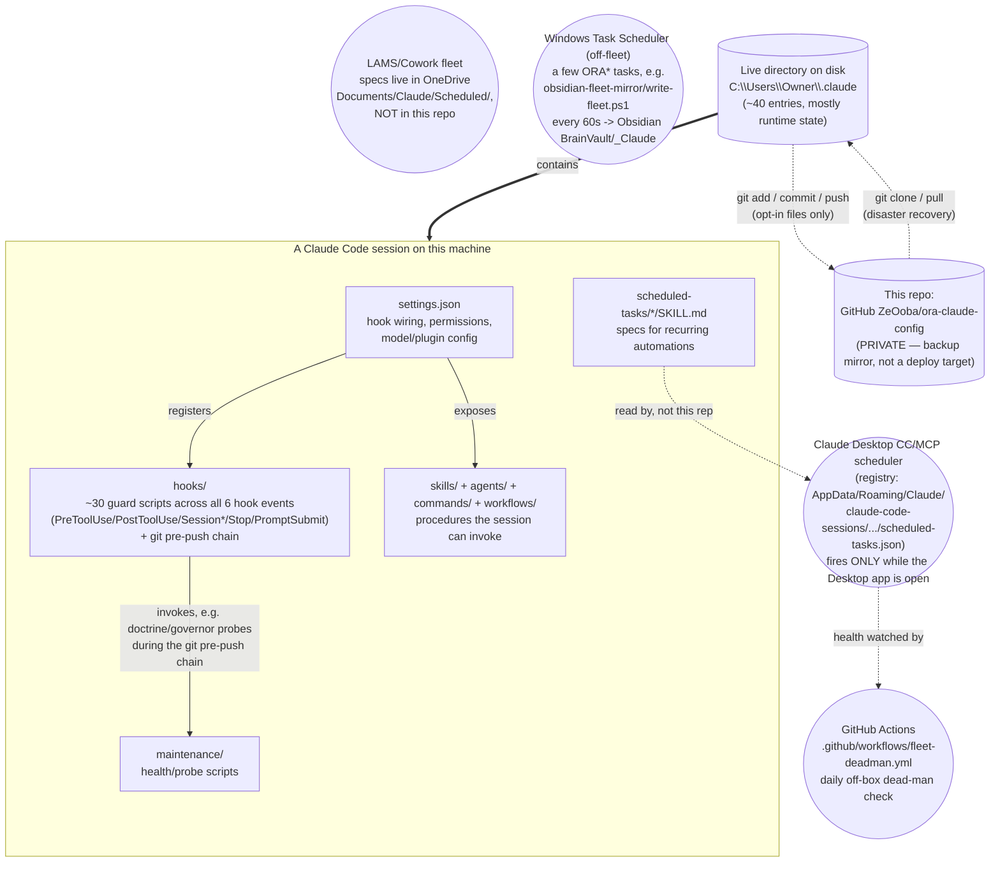

# ora-claude-config

**This is a config/backup repository, not an application.** It is the private GitHub
mirror (`ZeOoba/ora-claude-config`) of the `~/.claude` Claude Code configuration
directory that drives Oxford Realty Advisors' ("ORA") Claude Code automation — hooks,
skills, scheduled tasks, agents, commands, and workflows. It exists so that config,
skills, and hooks survive a lost/wiped machine, are diffable and code-reviewable like
any other source, and have a durable audit trail (git history) independent of the
live filesystem. Nothing here runs on its own — it is read and executed by Claude Code
itself when pointed at a `~/.claude` directory populated from this repo.

> Point-in-time doc, verified against the live repo 2026-07-26 — treat any count or
> path as directional and re-verify against `docs/system-inventory.md`
> (auto-refreshed weekly) and `session-context.md` (fleet roster, regenerated daily)
> before relying on a specific number.

---

## 1. What this repo is

`~/.claude` on the operating machine (`C:\Users\Owner\.claude`) is simultaneously (a)
Claude Code's live working directory — where it reads config and writes session/runtime
state every time it runs — and (b) this git repository. The two are the same folder;
there is no separate build/deploy step that produces one from the other. A `.gitignore`
with a **default-deny** policy (`/*` ignored, then explicit `!/path` opt-ins) decides
which of the ~40 top-level entries are versioned. Most of the directory is disposable
runtime state that never reaches GitHub (`cache/`, `sessions/`, `shell-snapshots/`,
`worktrees/`, `telemetry/`, `history.jsonl`, `.credentials.json`, `backups/`, `jobs/`,
`daemon/`, …); only named machinery — the actual configuration surface — is opted in
and pushed.

## 2. How the pieces relate

<!-- diagram-verified: 2026-09-18 -->

**Reading the diagram:** everything in the top box happens inside one live Claude Code
session. `settings.json` wires up the hooks and exposes the skills/agents/commands/
workflows a session can call; the hooks then guard every tool call and session-lifecycle
event that follows (not drawn as a self-loop — Mermaid rejects an edge from a subgraph's
own child back to the subgraph). `HOOKS -> MAINT` is a real, not illustrative, edge:
`hooks/git-prepush-doctrine-gate.py` directly launches
`maintenance/doctrine-integrity-probe.py` as part of the pre-push chain, so a hook calling
into a maintenance probe is load-bearing, not simplified for the picture.
`scheduled-tasks/*/SKILL.md` specs point outward to an
external scheduler node because they're read by the Claude Desktop CC/MCP scheduler, not by
this session directly. That scheduler is neither Windows Task Scheduler nor Cowork (an earlier
revision of this diagram said both): its registry lives under `AppData/Roaming/Claude/`, it
fires only while the Desktop app is open, and the LAMS/Cowork fleet's specs live in OneDrive
rather than here. Windows Task Scheduler does run a few off-fleet `ORA*` jobs (the
`obsidian-fleet-mirror` writer is the one whose scripts are tracked here), and
`fleet-deadman.yml` is the one check that runs off this machine entirely. Cadences are
deliberately not drawn: the live registry is the authority, and most tasks moved to weekly on
2026-09-17. Below that, the live directory on disk contains the whole session
and is the only thing that ever pushes to GitHub (dotted arrow, opt-in files only) — the
repo is downstream of the live directory, never the other way around: nothing deploys
*from* GitHub back into a running session automatically. A clone only becomes "live"
again when it's placed at `~/.claude` and Claude Code is pointed at it.

## 3. Directory structure

Verified against the actual tracked contents (`git ls-files`) and a sample of files in
each directory — not assumed from folder names.

| Path | What it actually contains |
|---|---|
| `CLAUDE.md` | The global operating prompt (identity, hard invariants, routing canon) loaded into every session. |
| `settings.json` | Hook wiring, permissions, model/plugin config — top-level keys include `hooks`, `permissions`, `enabledPlugins`, `env`, `model`, `statusLine`. |
| `hooks/` | ~25 guard scripts across all 6 hook events, not just PreToolUse (`confidentiality-guard.py`, `config-write-guard.py`, `shared-checkout-guard.py`, `ora-autonomy-gate.py`, `commit-provenance-guard.py`, `git-prepush-confidential-scan.py`, `git-prepush-doctrine-gate.py`, …) plus `bin/`, `lib/`, `tests/`, `active-work/`. `hooks/confidential-terms.json` (the confidential-deal roster) lives in this folder on disk but is **not tracked** by git. |
| `commands/` | 13 slash-command definitions (`build.md`, `debug.md`, `refactor.md`, `research.md`, `ship.md`, `plan.md`, `heavy.md`, `ram.md`, `handoff.md`, `solo.md`, `cleardisk.md`, `cleardisk-sessions.md`, `open-sessions.md`) — the Engineering-OS lane dispatch. |
| `agents/` | 17 custom sub-agent definitions (`adversarial-reviewer.md`, `comms-qc-reviewer.md`, `dd-package-sweep.md`, `deal-flow-triage.md`, `deal-recon.md`, `estoppel-reconciler.md`, `insurance-declaration-checker.md`, `lease-abstract-verifier.md`, `noi-opportunity-scout.md`, `open-items-triage.md`, `portfolio-anomaly-scout.md`, `psa-redline-checker.md`, `repro-isolator.md`, `security-auditor.md`, `site-qc-reviewer.md`, `tax-appeal-scout.md`, `underwriting-checker.md`). Domain-specific ORA agents, distinct from the general Cowork skill library. `lease-sweep` retired 2026-09-30 (copy at `archive/agents/`, local-only). |
| `skills/` | Only 5 ORA-authored skills are versioned here (`county-parcel-screen/`, `evidence-dossier-drafting/`, `external-artifact-intake/`, `ratify-hurdle-rate/`, `security-and-hardening/`), each with its own `SKILL.md` plus `references/`/`scripts/` subfolders. This is **not** the full skill catalog — most `anthropic-skills:*` skills Gabriel uses day to day are Cowork-synced runtime content and are not tracked in this repo. |
| `maintenance/` | 54 fleet/health/probe scripts and their tests (`fleet-status.py`, `doctrine-integrity-probe.py`, `governor-drift-probe.py`, `append-event-log.py`, `setup-self-audit.py`, `stuck-session-watchdog.ps1`, …) plus a `1-Check-My-Setup-SAFE.cmd`-style onboarding script set and `_state/`, `_applied/`, `_archive/`, `_shared/` subfolders. |
| `scheduled-tasks/` | One folder per scheduled task (48+ live/archived folders observed); **only each task's `SKILL.md` spec is tracked** — runtime state, logs, and `.bak` files are not. Includes a large set of dated `_archive_*_retired` / `_archive_*_orphans` subfolders preserving retired task specs. |
| `_scheduled_tasks_backup/` | A second, redundant-by-design snapshot of task `SKILL.md` specs (107 entries observed) — a belt-and-suspenders backup of `scheduled-tasks/`. |
| `workflows/` | 3 named multi-agent `Workflow` scripts (`cc-audit-army.js`, `cc-eval-plan-premortem.js`, `verified-deal-recon.js`) plus a `README-cc-self-audit.md` and a `_tests/` prompt-snapshot rig. |
| `mcp-servers/` | Only `fred/` — a self-authored FRED (St. Louis Fed) MCP server; the only custom MCP server versioned here. |
| `obsidian-fleet-mirror/` | Scripts that mirror live fleet state into an Obsidian-readable form; the actual state files they produce are deliberately untracked. |
| `prompts/` | Standing prompt templates used for recurring autonomous runs, plus an `_archive/` of retired ones. |
| `docs/` | `system-inventory.md` (weekly-refreshed environment snapshot), `MIGRATION_RUNBOOK.md`, dated build reports, and a `superpowers/` subtree of design specs/plans for the Engineering-OS work. |
| `.github/workflows/` | 2 CI workflow files (`claude-ci-fix.yml`, `fleet-deadman.yml`). |
| `projects/…/memory/` | The ORA memory system — only the nested `C--Users-Owner-OneDrive---Oxford-Capital-Partners/memory/` path is tracked (204 files: `MEMORY.md` index, `event_log.md`, dated deal/project/reference notes). Raw session transcripts (`.jsonl`) elsewhere under `projects/` are **not** tracked. |
| `_archive/` | Superseded config, retired hooks, and pre-trim snapshots — files are moved here rather than deleted. |
| `confidential-repos.json` | A small roster naming which *other* ORA repos require confidentiality gating on code-review tooling, plus the rule text explaining why — see §5 below; contents not enumerated in this README. |
| `keybindings.json`, `.gitattributes`, `daily-setup-audit-prompt.md` | Small standalone config/reference files, individually opted in. |

Everything else visible on disk (`cache/`, `sessions/`, `worktrees/`, `telemetry/`,
`.credentials.json`, `backups/`, `jobs/`, `daemon/`, `shell-snapshots/`,
`session-env/`, `handoffs/`, `plans/`, `tasks/`, `ide/`, `paste-cache/`, `artifacts/`,
`downloads/`, `history.jsonl`, `.last-cleanup`, …) is intentionally absent from
GitHub — secret, machine-specific, or freely regenerable.

## 4. What this repo is NOT

- **Not runnable software.** There is no build step, no `npm start`/`pip install -r
  requirements.txt` entry point, and no service that gets deployed from this repo. The
  `.py`/`.js`/`.ps1` files here are hooks, probes, and workflow scripts that only do
  anything when Claude Code (or Windows Task Scheduler / a `.cmd` launcher) invokes
  them directly on the machine where `~/.claude` lives.
- **Not a source→deploy pipeline.** The `.github/workflows/` CI here checks the repo's
  own hygiene (e.g. a fleet dead-man check); it does not build or ship a product.
- **How it's actually used:** this repo is synced onto a machine by being cloned to (or
  already living at) that machine's `~/.claude` path — on Windows specifically
  `C:\Users\Owner\.claude`, since hardcoded hook paths in `settings.json` assume that
  profile name. Claude Code then reads it as ordinary config on every session start.
  Restoring a machine means `git clone` into that path, then separately recovering the
  secrets and live state this repo deliberately excludes (`.credentials.json`,
  `_shared/*.dat`, live scheduled-task registries) — see `docs/MIGRATION_RUNBOOK.md`
  for the full cold-start sequence, and `python maintenance/fleet-status.py --summary`
  / `doctrine-integrity-probe.py` / `governor-drift-probe.py` to verify health once
  running.

## 5. Confidentiality note

This is a **PRIVATE** GitHub repository (`ZeOoba/ora-claude-config`). Even so:

- **`confidential-repos.json`** — a roster of other repos that require confidentiality
  gating (e.g. blocking certain cloud code-review tooling on them) because they may
  embed deal figures, tenant data, or site content under a never-touch guardrail. Its
  contents are not enumerated in this README by design — treat it as a pointer, not a
  disclosure surface.
- **`hooks/confidential-terms.json`** — the live roster of active confidential deal
  terms. It resides in `hooks/` on disk but is git-ignored outright (confirmed not
  tracked); it never reaches this repo's history.
- Every `git push` from this checkout is additionally scanned by
  `hooks/git-prepush-confidential-scan.py`, which checks full history
  (`git log -p --all`), not just the current diff, before anything leaves the machine.
- Deal-specific content, tenant PII, and credentials should never be described in
  specifics anywhere in this repo's own documentation (including this README) — only
  generically, by reference to the file/mechanism that holds them.

---

## 6. Known caveats

- The working tree routinely carries uncommitted changes from other in-flight sessions
  (scheduled-task `SKILL.md` backups, memory event-log appends, registry-membership
  snapshots) — this is normal churn from the fleet's own probes, not drift to fix.
  `~/.claude` is a **shared, single-writer checkout**: confirm a file is actually yours
  (via `git status` / `git log -1`) before committing it, and prefer an isolated
  worktree for any non-trivial edit.
- `skills/` here is intentionally small (5 skills). Do not treat it as the full skill
  catalog when auditing what's "in" this system — cross-check `docs/system-inventory.md`
  and the separate Cowork skill-sync location instead.
- Live scheduled-task counts, crons, and registry state are **generated daily** into
  `session-context.md` and are never hand-maintained in this README or in
  `docs/system-inventory.md` — treat any headline number here as stale by the time you
  read it.

---

*This README is itself an opt-in (`.gitignore` `!/README.md`) — if it stops appearing
on GitHub after a `.gitignore` edit, that opt-in was the thing that broke.*
