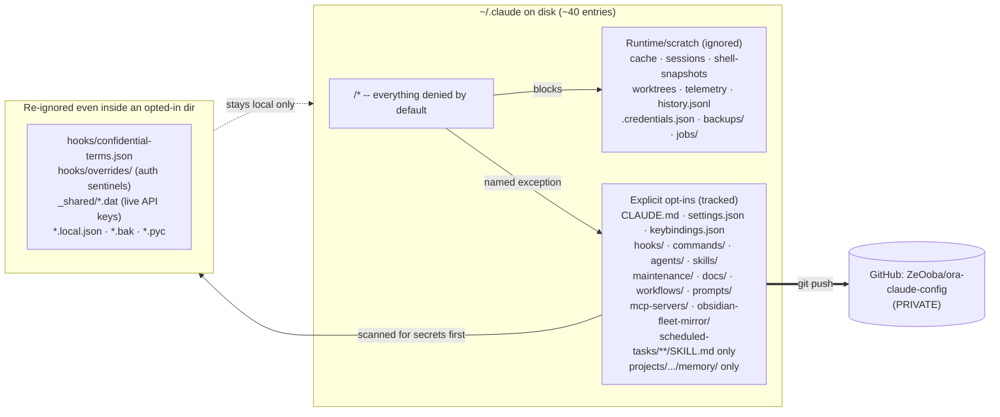
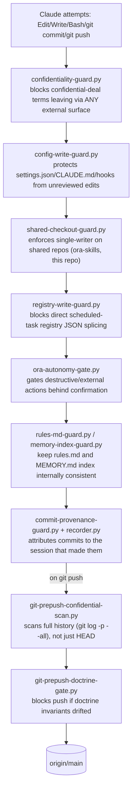
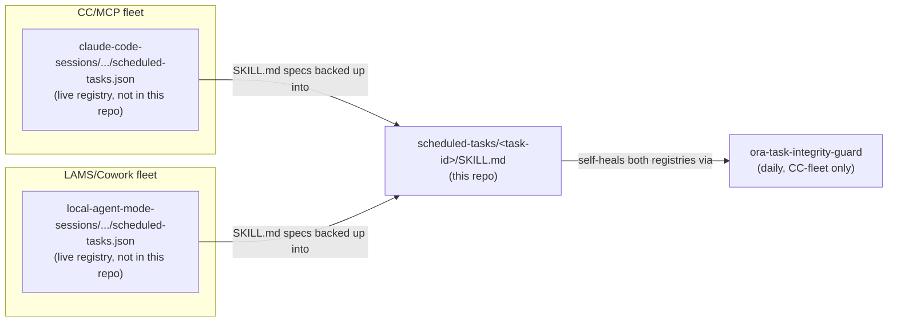

# ora-claude-config

Private GitHub backup of the Claude Code global config that runs Oxford Realty Advisors'
operations (`ZeOoba/ora-claude-config`). The local directory is `~/.claude` on the
operating machine; **this repo is a curated, fail-closed slice of it** — not a mirror of
the whole folder. If you're reading this cold (new machine, new session, disaster
recovery), start at [§5 Cold start](#5-cold-start--if-this-machine-is-gone).

> Point-in-time doc. Counts/paths verified 2026-07-26 — treat as directional, re-verify
> against `docs/system-inventory.md` (auto-refreshed weekly) and `session-context.md`
> (fleet roster, regenerated daily) before relying on a number here.

---

## 1. What actually gets backed up

`~/.claude` on disk holds ~40 top-level entries — most of it is disposable runtime state
(`cache/`, `sessions/`, `shell-snapshots/`, `worktrees/`, `telemetry/`, `history.jsonl`,
`.credentials.json`, …). `.gitignore` is **default-deny**: it ignores `/*` and then
opts in only the directories/files worth versioning. Nothing reaches GitHub unless it's
named explicitly.

**Why this is the failure-proof part:** because the default is deny, a stray
`git add -A` cannot leak a secret that was never named as an opt-in — the miss has to
happen twice (opt in the directory *and* fail to re-ignore the specific file) for
anything sensitive to reach the remote. The `_shared/` opt-ins are deliberately
per-file, not per-directory, because that folder also holds `anthropic-key.dat`,
`netlify-token.dat`, and a full send log — see the comments in `.gitignore` §"3) Re-ignore
secrets" before ever widening an opt-in there.

Confidential deal terms get the same treatment one layer up: `hooks/confidential-terms.json`
(the roster) is git-ignored outright, and any push is additionally scanned by
`hooks/git-prepush-confidential-scan.py` before it leaves the machine.

---

## 2. Repo layout

| Path | What it is | Notes |
|---|---|---|
| `CLAUDE.md` | Global operating prompt — identity, hard invariants, routing canon | Loaded into every session; canonical over memory |
| `settings.json` | Hook wiring, permissions, plugin toggles | Edit-deny outside explicit permission |
| `hooks/` | PreToolUse/PreCommit guard scripts (~20 `.py` + `bin/`, `lib/`, `tests/`) | See [§3](#3-guard-layer-hooks) |
| `commands/` | Engineering-OS slash commands (`/build`, `/debug`, `/refactor`, `/ship`, …) | Lane dispatch L1–L7 |
| `agents/` | Custom sub-agent defs (deal-recon, underwriting-checker, lease-sweep, site-qc-reviewer, portfolio-anomaly-scout, deal-flow-triage, security-auditor) | Domain-specific, not the Cowork skill library |
| `skills/` | A handful of ORA-authored skills versioned here (county-parcel-screen, evidence-dossier-drafting, external-artifact-intake, ratify-hurdle-rate, security-and-hardening) | **Not** the full skill catalog — most `anthropic-skills:*` skills are Cowork-synced runtime content that lives elsewhere and isn't tracked in this repo |
| `maintenance/` | Fleet/health/probe scripts (`fleet-status.py`, `doctrine-integrity-probe.py`, `governor-drift-probe.py`, `append-event-log.py`, …) + their tests | The operational nervous system — run these to check "is the brain healthy" |
| `scheduled-tasks/` | One folder per scheduled task; **only `SKILL.md` is tracked**, runtime state (`_state/`, logs, `.bak`) is not | Plus a handful of individually-allow-listed durable engine scripts — see `.gitignore` §2b/§2c |
| `_scheduled_tasks_backup/` | Secondary backup snapshot of task specs | Redundant-by-design mirror |
| `workflows/` | Named multi-agent `Workflow` scripts (`.js`) + their prompt-snapshot tests | `cc-audit-army`, `cc-eval-plan-premortem`, `verified-deal-recon` |
| `prompts/` | Standing prompt templates for recurring autonomous runs | |
| `mcp-servers/fred/` | Self-authored FRED (St. Louis Fed) MCP server | Only custom MCP server versioned here |
| `obsidian-fleet-mirror/` | Scripts that mirror live fleet state into an Obsidian-readable form | `session-state.json`/`.d/` deliberately untracked (rewritten every few minutes) |
| `docs/` | `system-inventory.md` (weekly-refreshed snapshot), `MIGRATION_RUNBOOK.md`, build reports | Start here for environment facts |
| `.github/workflows/` | CI | |
| `projects/…/memory/` | The ORA memory system (this session's persistent knowledge base) | Only this nested path under `projects/` is tracked — raw session transcripts (`.jsonl`) are not |
| `_archive/` | Superseded config, retired hooks, pre-trim snapshots | Never hard-deleted, moved here instead |

Everything else visible locally (`cache/`, `sessions/`, `worktrees/`, `telemetry/`,
`.credentials.json`, `backups/`, `jobs/`, `daemon/`, …) is intentionally absent from
GitHub — it's either secret, machine-specific, or regenerable.

---

## 3. Guard layer (`hooks/`)

Every write/commit/push is wrapped by a chain of fail-closed PreToolUse and git hooks,
not just the `.gitignore` allow-list:

Guard scripts fail **open** on their own errors (a crashed probe never blocks work) but
fail **closed** on a positive match (a real confidentiality hit blocks unconditionally).
Full inventory and lifecycle bindings: `docs/system-inventory.md` → "Hooks" section.

---

## 4. Scheduled fleet (dual-registry doctrine)

`scheduled-tasks/` in this repo versions the **spec** (`SKILL.md`) for every recurring
automation, but the automations themselves run against two live, unversioned registries
on the operating machine — not against this repo:

Both registries fire only while their host app is open — a closed app means the whole
chain fires as a catch-up burst at next open, not silently on schedule. Live task
counts/crons are **generated daily** into `session-context.md`, never hand-maintained
here — treat any headline number in this README or in `docs/system-inventory.md` as
already stale by the time you read it.

---

## 5. Cold start — if this machine is gone

1. Clone this repo to the new machine's `~/.claude` path — **the Windows profile must
   be named `Owner`** (`C:\Users\Owner`) or every hardcoded hook path in `settings.json`
   breaks at first session. Full provisioning order: `docs/MIGRATION_RUNBOOK.md`.
2. This repo restores config, hooks, skills, agents, commands, and task *specs* —
   it does **not** restore secrets (`.credentials.json`, `_shared/*.dat`), live registry
   state, or memory outside `projects/…/memory/`. Those need their own recovery path
   (password manager / OneDrive / re-auth) — see `docs/MIGRATION_RUNBOOK.md` for each.
3. Verify health once running: `python maintenance/fleet-status.py --summary` (fleet),
   `python maintenance/doctrine-integrity-probe.py` (invariant drift),
   `python maintenance/governor-drift-probe.py` (DSCR/LTV constants unchanged).
4. Deeper architecture map + full runbook: memory file `00_system_of_record.md`
   (`projects/…/memory/`) — the "operate this cold" section there is the canonical
   version of this section; this README summarizes it for a GitHub-only reader.

---

## 6. Known caveats (as of 2026-07-26)

- **`git push` to this repo has been observed hanging past the client timeout**
  (open item OI-028, logged 2026-07-26) — if a push appears stuck, check for a hung
  process before assuming failure; do not force-kill without checking `git status` first.
- The working tree routinely carries uncommitted changes from other in-flight sessions
  (scheduled-task SKILL.md backups, memory event-log appends, registry-membership
  snapshots) — this is normal churn from the fleet's own probes, not drift to fix.
  Confirm a file is actually yours before committing it; see the single-writer rule in
  `CLAUDE.md`.
- `skills/` here is intentionally small. Do not treat it as the full skill catalog when
  auditing what's "in" this system — cross-check `docs/system-inventory.md`'s plugin
  list and the Cowork skill sync location instead.

---

*This README is itself an opt-in (`.gitignore` `!/README.md`) — if it stops showing up
on GitHub after a `.gitignore` edit, that opt-in was the thing that broke.*
