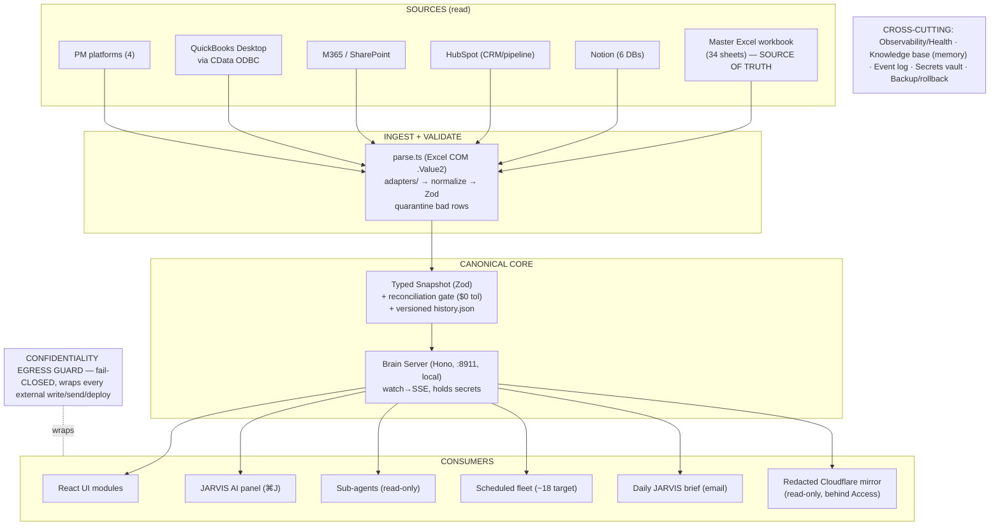

# ORA Company Brain — System of Record (SoR)

**Authored:** 2026-06-03 (Phase 0.2 of the JARVIS-spine overhaul). **Owner:** Gabriel Goldberg, Principal.
**Purpose:** the one doc a fresh engineer (or fresh Claude) reads to operate this system cold. If you can't run the brain from this file + the repo, this doc is incomplete — fix it.

> **Status note:** the overhaul is mid-flight. Phase 0 (backup, this doc, governor fix) and Phase 1 (guardrails) ship first and are non-destructive. Phases 2–6 are gated on G1/G3/G4 (see Decisions). Tags below reflect the **target** disposition; "live?" columns reflect **current** reality.

---

## 1. How to operate this cold (runbook)

- **"Is the brain healthy?"** → run `python ~/.claude/maintenance/fleet-status.py` (canonical fleet health; the `scheduled-tasks` MCP returns 0 **by design** — never use it). Once Phase 5 ships, the System Health module in the React app is the one-glance surface.
- **"What's the source of truth for a financial fact?"** → the Master Excel workbook (§4), read live via Excel COM `.Value2`. Everything else is secondary and joined onto it. On disagreement, the workbook wins and the discrepancy is a data-quality exception.
- **Start the brain locally:** `cd C:\Users\Owner\oxford-command-center` → `npm run dev` (Vite client + Hono Brain Server on :8911, chokidar→SSE off the workbook). Gate before deploy: `npm run gate` (typecheck · lint · tests · `reconcile` to the $).
- **Send email (automated/scheduled):** Outlook COM via `_shared/send-via-outlook.ps1` is the SOLE path. **Composio fallback REMOVED 2026-06-11** (connector gone). On non-zero exit: retry once, then flag loudly (automation-health-monitor producer-beacon check catches the silent send). No Gmail. Rube retired — never reference it.
- **Discover the live scheduler registries (TWO — dual-fleet doctrine 2026-06-10):** newest non-empty `scheduled-tasks.json` under BOTH `…\claude-code-sessions\<guid>\<guid>\` (CC/MCP fleet) AND `…\local-agent-mode-sessions\<guid>\<guid>\` (LAMS/Cowork fleet). **Never hardcode the GUID** — it rotates (I4). `maintenance/fleet-status.py` does this automatically.
- **Recover from a bad change:** restore from the newest `~/.claude/backups/brain-overhaul-<ISO>/` (manifest has byte counts). Nothing is hard-deleted without per-item sign-off.
- **Governor (hard acquisition screen):** DSCR ≥ 1.25× and LTV ≤ 40%. `CLAUDE.md` is canonical (G5).

---

## 2. Architecture

---

## 3. Canonical decisions

| Gate | Decision | Status |
|---|---|---|
| G1 | Canonical brain = React `oxford-command-center`; retire ECharts 7-pager + static prototype after porting gaps | **OPEN** — confirm before Phase 2 |
| G2 | Hosting = Hybrid (Option D), $0. Brain Server + scheduler local; redacted Cloudflare mirror behind Access is the only remote surface | **RESOLVED** |
| G3 | Memory → ~8 living docs + one append-only event log; supersede "never overwrite/never delete" for current-state docs | **OPEN** — confirm before Phase 4 |
| G4 | Fleet 45 → ~18; strip all autonomous config/memory mutation | **OPEN** — confirm before Phase 3 |
| G5 | Governor = DSCR ≥ 1.25×, LTV ≤ 40%; `CLAUDE.md` correct, memory corrected down | **RESOLVED** (applied Phase 0.3) |

---

## 4. Data sources & authority order

Authority (financial facts): **Master workbook → Notion → HubSpot → M365 → QuickBooks Desktop → PM platforms.**

| Source | Path / locus | Tag | Notes |
|---|---|---|---|
| Master Excel workbook | `…\eric spreadsheets\Master Excel Template Company Wide -- Oxford.xlsx` (34 sheets) | **CANONICAL source** | Read live via Excel COM `.Value2` (openpyxl/Excel-MCP return formulas — not values). Locked-open on OneDrive → copy-to-local-then-open. |
| Notion (6 DBs) | `mcp__c5f4869f…__notion-*` | CANONICAL (secondary) | Deal pipeline, tenants, knowledge base. |
| HubSpot | `mcp__a3e380ce…__*` | CANONICAL (secondary) | CRM / pipeline. |
| M365 / SharePoint | `mcp__c0ea3c01…__*` | CANONICAL (secondary) | Calendar/email/SharePoint search. |
| QuickBooks Desktop | CData ODBC bridge (to stand up) | CANONICAL (secondary) | **Desktop only** — Intuit QBO MCP non-functional. Phase 2: CData ODBC adapter **or** labeled stub (never silent half-coverage). |
| PM platforms (4) | Yardi=MD/Baltimore, AppFolio=Columbus, Rent Manager=IN/KC, QB Desktop=accounting (~20 LLCs) | CANONICAL (secondary) | SharePoint CSV export + parse. |

---

## 5. The brain (canonical nucleus)

| Item | Value | Tag |
|---|---|---|
| Repo | `C:\Users\Owner\oxford-command-center` (git; GitHub `ZeOoba/oxford-command-center`, private) | **CANONICAL** |
| Stack | Vite + React 19 + TS client; **Hono Brain Server :8911** (local, holds secrets); chokidar→SSE; Zod | CANONICAL |
| AI panel | `server/ai/claude.ts`, model `claude-opus-4-8`; deterministic `respond.ts` fallback | CANONICAL |
| Macro | `server/macro/fred.ts` (FRED rate strip) | CANONICAL |
| Gate | `npm run gate` = typecheck · lint 0 · tests · `reconcile` ($0 tolerance vs workbook totals) | CANONICAL |
| Reconciliation | snapshot totals cross-checked vs workbook total cells; failing reconcile blocks deploy | CANONICAL |

---

## 6. Dashboards

| Dashboard | Path / URL | Tag |
|---|---|---|
| React command center | `oxford-command-center` (local + redacted Cloudflare mirror behind Access) | **CANONICAL** |
| ECharts 7-pager | `ora-command-center.pages.dev` / `C:\Users\Owner\oxford-perfection\ora-dashboard\` | **RETIRE** (port gaps → redirect, Phase 2/G1) |
| Static prototype | `…\Claude_Workspace\…\oxford_dashboard.html` | **ARCHIVE** (Phase 2/G1) |

---

## 7. Scheduled fleet — CURRENT STATE: **TWO live registries; the AUTHORITATIVE counts + roster are GENERATED into `~/.claude/session-context.md`** by `registry-membership-probe.py` daily — read them there, NEVER from a hand-written number here (hand-written fleet counts were the recurring drift class; de-hardcoded 2026-07-09, and `setup-self-audit.py` Check 5 now WARNs if a count creeps back into this section's headline). Ratified fleet floors (tripwires, not targets): `~/.claude/maintenance/_shared/scheduler-stores.json`. Full dispositions: `00_Governance/outputs/2026-06-10_fleet-disposition-ledger.md`

> **DUAL-FLEET DOCTRINE (2026-06-10 — supersedes both the 6/06 "store migration" note and the "LAMS orphaned/dark" claim, which was WRONG):** (1) **CC/MCP fleet** (incl. `ora-task-integrity-guard` 12:45, added 2026-06-11): registry `claude-code-sessions\…\scheduled-tasks.json`, SKILL.mds in `~/.claude/scheduled-tasks/`, managed via the `scheduled-tasks` MCP (sees ONLY this store). (2) **LAMS/Cowork fleet**: registry `local-agent-mode-sessions\…\scheduled-tasks.json`, SKILL.mds in `OneDrive…\Documents\Claude\Scheduled\` — 2026-06-11 example roster, since grown (live roster: session-context.md): ora-om-intake-ocr (Wed 06:15) · ora-replacement-cost-refresh (quarterly) · ora-cowork-heartbeat (05:50 daily; 1x/day since 2026-08-05, registry cron `50 5 * * *`) · ora-skill-store-drift-check (Mon 12:10). The retired LAMS `scheduled-task-integrity-guard` entry remains disabled in the registry (Cowork-UI removal pending). Cowork-created tasks land in LAMS **by platform design**. Both fleets fire only while the app is open (Keep awake ON). PRESENCE+MEMBERSHIP: `fleet-status.py` (dual-fleet) + `registry-membership-probe.py` (daily, alarms on silent entry drops — the failure mode that left the heartbeat dark 2026-05-31→06-10). Run-LIVENESS: `[ORA] Health Guard` email · GitHub `ora-cowork-watchdog` (canonical-ID fetch, patched+re-enabled 2026-06-10) · `list_scheduled_tasks` (CC only). File self-healing: CC `ora-task-integrity-guard` (12:45; LAMS twin retired 2026-06-11; engines relocated into its own folder) restores SKILL.mds across BOTH registries from 2 mirrors — note disabled-but-registered tasks get their folders RESTORED if archived; remove the registry entry first. Retired (do NOT re-register): 8 Tier-2 (2026-06-09) + 4 inbox sweeps (2026-06-10) — see the disposition ledger. The LAMS detail below is pre-Stage-2 history only.

> **Stage 2 applied 2026-06-03 — fleet 43→29** (landed at 29, not the dry-run's 27 — see event_log 2026-06-06). **⚠ 2026-06-06: the LAMS scheduler engine was found DARK since 2026-05-31 22:17Z — no task fired for ~6 days while the app was running. Out-of-band Windows dead-man's-switch installed (`~/.claude/maintenance/fleet-deadman.ps1`, daily 07:30) to alarm on >26h silence. Restore = full Claude Desktop restart + re-home tasks (owner sessions dead). Read live health via `~/.claude/maintenance/setup-self-audit.py`.** The 6 SKILL merges are live: `ora-am-brief` (0 6; AM brief+inbox+treasury+cash), `ora-pm-ledger` (0 18; digest+outbox-qc+eod-ledger), `ora-quarterly-compliance` (0 9 1 1,4,7,10; covenant+insurance+tax+cre-data), `ora-weekly-hygiene` (0 20 * * 0; workspace+onedrive+sharepoint+artifact+session), `ora-health-guard` (15 5; integrity+preflight+cc-verifier+4 probes), `ora-dashboard-refresh` (retimed 0 7). Kept separate: `ora-dormant-thread-revival` (Fri 15:00), `ora-automation-health-monitor` (11:00 wd). 21 source/dead tasks deleted. `fleet-status.py` "ATTENTION" verdict post-swap is benign: never-ran=newly-created-or-awaiting-cron; throttle-skips 237=stale `recordedSkips` from now-deleted tasks; collisions=benign cross-cadence. **Optional future app-closed cleanup:** retime `loopnet-autoreply` 3×→2×/day (`0 8,17`); prune `recordedSkips` of deleted-task entries. The snapshot below is the pre-Stage-2 (45/43) historical state, retained for reference.

### Historical pre-Stage-2 snapshot (45 tasks, live LAMS registry 2026-06-02)

Registry: `…\local-agent-mode-sessions\a6ad2c61…\583f08bc…\scheduled-tasks.json` (auto-discover; **CANONICAL**). The `scheduled-tasks` MCP reads the emptied CCS registry → returns 0 **by design**; do not use for health — run `fleet-status.py`.

**Verified metrics (2026-06-03 via fleet-status.py):** 45 tasks (42 enabled / 3 disabled); **12 never-ran**; **4 one-time fireAt** (2 EXPIRED: `hard-delete-zapier-trial-reminder`, `ora-quarterly-cron-restore-20260521` → delete in Phase 3); **237 throttle-skip events across 13 tasks** (top: inbox-pre-brief 36, cowork-heartbeat 34, sharepoint-aging 31); **4 same-time collisions** (07:00 ×5, 08:30 ×2, 09:00 ×4, 09:30 ×2); **23 tasks in the 05:00–09:30 AM pileup**.

**Disabled (3):** `hard-delete-zapier-trial-reminder`, `ora-connector-recovery-ratification-check`, `ora-quarterly-cron-restore-20260521`.
**Never-ran (~12, lastRunAt empty):** `efulton-post-legalhold-consolidation`, `hard-delete-zapier-trial-reminder`, `ora-cam-reconciliation-annual`, `ora-cc-implementation-verifier`, `ora-connector-recovery-ratification-check`, `ora-consolidate-memory-monthly`, `ora-counsel-review-standard-positions`, `ora-dashboard-finish`, `ora-dashboard-refresh`, `ora-distress-signal-monitor`, `ora-notion-daily-digest`, `ora-pm-ar-export-freshness-check`.
**One-time fireAt (epoch ms):** `efulton-post-legalhold-consolidation` (confidential, E. Fulton), `ora-counsel-review-standard-positions`, `hard-delete-zapier-trial-reminder` (disabled), `ora-quarterly-cron-restore-20260521` (disabled, already ran).
**AM pileup (05:15–09:30):** connector-preflight (5:25), treasury-prefetch (5:40), workbook-ingest (5:45 Mon), integrity-guard (5:15), daily-brief (6:00), cash-snapshot (6:50 Mon), cowork-heartbeat (6:10), inbox-pre-brief (6:30), cc-verifier (7:45), dashboard-refresh (7:00) — Phase 3 staggers these.

**Target disposition (Appendix B, Phase 3/G4 — consolidate 45 → ~18):**
- **AM brief** ← daily-brief-6am + inbox-pre-brief + treasury-yield-prefetch + cash-position-snapshot
- **PM ledger** ← outbox-qc-sweep + eod-action-ledger + dormant-thread-revival + notion-daily-digest
- **Quarterly compliance** ← lender-covenant-tracker + insurance-renewal-tracker + tax-appeal-calendar + cre-data-mcp-recheck
- **Weekly hygiene** ← artifact-staleness-scan + sharepoint-aging-freshness-check + onedrive-cleanup + session-pruner + claude-workspace-hygiene
- **Health guard** (authored 2026-06-03; `15 5 * * *`) ← scheduled-task-integrity-guard + connector-preflight-guard + cc-implementation-verifier **+ wired-in probes** (fleet-status / governor-drift / memory-integrity / confidentiality self-test). NOTE (2026-06-03): `automation-health-monitor` kept SEPARATE (~11:00 — must run after the morning batch to verify fires) and `connector-recovery-ratification-check` DROPPED (obsolete) — neither folds in.
- **Dashboard refresh** ← one task for the React mirror (kill dashboard-refresh + dashboard-finish ECharts)
- **Keep distinct:** loopnet-autoreply (3×→2×/day), master-workbook-ingest, monthly-close-kickoff, tenant-at-risk-monthly, distress-signal-monitor, cam-reconciliation-annual, annual-budget-kickoff, acs-graduate-migration-annual-refresh, week-ahead-briefing, consolidated memory-integrity + governor-drift weekly probe.
- **Delete:** hard-delete-zapier-trial-reminder + the two expired fireAt tasks. **Resolve (fix or cut):** the ~12 never-ran.

---

## 8. Hooks (`~/.claude/hooks/`)

| File | Role | Tag |
|---|---|---|
| `confidentiality-guard.py` | PreToolUse multi-surface egress guard (site/outputs/mirror/Notion/Outlook/egress-bash); **FAIL-CLOSED**; reads `confidential-terms.json` | **DONE** (Phase 1.2; settings.json matcher widened from `Edit\|Write`) |
| `fleet-session-hook.py` | SessionStart context loader / fleet mirror | KEEP (review) |
| `confidential-terms.json` | Deal-keyed term list (E. Fulton seeded; always/context terms; quarterly review) | **DONE** (Phase 1.2) |
| `test-confidentiality-guard.py` | Blocking test suite — every Appendix-C variant × every surface | **DONE** (Phase 1.2; 168/168 pass) |

---

## 9. Maintenance scripts (`~/.claude/maintenance/`)

| File | Role | Tag |
|---|---|---|
| `apply-scheduler-maintenance.py` | App-closed registry edit pattern | HARDEN (auto-discover, `[ACTION]` alerts — I4/I5) |
| `cc-verifier-probe.py` | CC implementation verifier | HARDEN |
| `scrub-rube-from-registry.py` | One-shot Rube removal (done) | ARCHIVE candidate |
| `governor-drift-probe.py` | DSCR/LTV drift detector — flags any governor declaration off the canonical 1.25x / 40% (declaration lines only; legacy-value regression sentinel) | **DONE** (Phase 1.1; exits 0 on clean tree, 201 files) |
| `fleet-status.py` | **Canonical fleet health** — DUAL-FLEET (2026-06-10): auto-discovers BOTH registries (CC + LAMS, no hardcoded GUIDs), per-fleet table + skips/collisions/never-ran. `--json`/`--summary` | **DONE** (dual-fleet 2026-06-10) |
| `memory-integrity-probe.py` | Index↔files reconciliation + contradiction/recipient/retired-link checks + staleness warnings (report-only) | **DONE** (Phase 4.D; exit 0, 12↔12) |
| `restore-skill-governor.py` | One-command idempotent re-apply of the 1.25× governor in the 2 Cowork-cloud skills if a sync reverts them (`--check` to detect). Companion to the drift probe. | **DONE** (verified detect+fix) |
| `apply-fleet-consolidation.py` | Phase 3 Stage 1 — app-closed, backed-up, idempotent deletion of the 2 expired/disabled tasks. Launcher: `Desktop/Apply-Fleet-Consolidation.cmd`. (Stage 1 deletions already applied directly; this is the fallback.) | **applied (45→43)** |
| `apply-fleet-consolidation-stage2.py` | Phase 3 Stage 2 — app-closed, backed-up, atomic, idempotent. ADDs the 5 merged tasks (perms unioned from sources), RETIMEs `ora-dashboard-refresh`→`0 7 * * *`, DELETEs the 21 folded/killed sources. Invariant: never deletes a folded source unless its replacement merged task exists post-run; refuses to add a task whose SKILL.md is missing; never touches dormant/health-monitor. `--dry-run` previews. Launcher: `Desktop/Apply-Fleet-Consolidation-Stage2.cmd`. Dry-run verified 43→27; **applied — fleet landed at 29** (live 2026-06-06). | **applied (43→29)** |
| `normalize-send-paths.py` | Fleet send-path remediation — exact-string repoint of 18 SKILLs from the dead `8a611864` wrapper → live `composio-ora`/`send-via-outlook.ps1`. Allowlisted, idempotent. | **DONE** (19/19 incl. daily-brief; verified) |

---

## 10. Connectors / MCPs (server-level)

Notion (`c5f4869f…`) · HubSpot (`a3e380ce…`) · M365/SharePoint (`c0ea3c01…`) · `excel` · `fred` (self-authored St. Louis Fed — **live and registered, corrected 2026-07-12**; see tech.md §4) · Desktop Commander · Claude-in-Chrome · computer-use · chrome-devtools · context7 · **Apify (Cowork surface; ratified 2026-07-16 — listing/parcel-page web extraction serving deal sourcing + parcel-data-recovery)** · **scheduled-tasks (LIVE create/read path** for the Desktop fleet — `create_scheduled_task`/`list_scheduled_tasks` write/read `~/.claude/scheduled-tasks/<id>/SKILL.md`; the old "returns 0 by design / never use" note was WRONG — corrected 2026-06-06). **Netlify:** MCP first, `npx netlify-cli` fallback. **Zapier: RETIRED — removal ratified 2026-07-16** (Gabriel; had been de-authed/absent from the live tool list since 2026-06-22 — never re-auth; see tech.md §4). **Rube:** retired (EOL 2026-05-15) — never reference. **composio-ora (Outlook write bridge): REMOVED 2026-06-11** — no longer configured (verified: no `mcpServers` key in `claude_desktop_config.json`); Outlook sends are COM-only via `_shared/send-via-outlook.ps1`. (This line corrected 2026-07-09 — previously misstated composio-ora as still active.) **Grain (`468d2dad…`) and Windows-MCP removed from this list 2026-07-12** — both confirmed dead (absent from live tool registry and `settings.json` permissions); see tech.md §4 for detail.

---

## 11. Secrets index (locations only — never values)

`.env` / `.dat` files, git-ignored. Edit-deny on `*credentials*` / `.env`. Brain Server holds runtime secrets locally (not in client/mirror). Cloudflare: prefer a non-expiring scoped API token over copied OAuth creds for unattended deploys. No tokens in URLs or memory.

---

## 12. Knowledge base / memory (`…\memory\`)

**DONE (Phase 4/G3, 2026-06-03): 31 → 13 files.** Living docs (overwritten to current state): `00_system_of_record.md` (this), `firm.md`, `user.md`, `people.md`, `markets.md`, `standards.md`, `tech.md`, `rules.md`, `projects.md`. Append-only: `event_log.md`. Operational: `reference_tenant_name_mappings.md`. Meta: `MEMORY.md` (1:1 index), `memory-policy.md` (rewritten to overwrite-current-state + history→log model). History accrues in the event log. `ORA_SetupReference.md` + 17 other sources archived to `memory/_archive/` (no hard deletes). `memory-integrity-probe.py` enforces (exit 0, index 12↔12). *(13 physical files vs the spec's "≤~10": the 8 named living docs + projects.md + event_log = 10, plus index/policy/tenant-data meta.)*

---

## 13. Skills

Cowork user-skills live (runtime, read-only, synced) at `…\local-agent-mode-sessions\skills-plugin\583f08bc…\a6ad2c61…\skills\<skill>\SKILL.md` (~39 skills, 261 files, 7.4 MB). Editable from Code but re-sync in the Cowork editor reverts direct edits — mirror durable changes there. Manifest: `…\a6ad2c61…\manifest.json`. Sub-agents: `~/.claude/agents/*.md` (**6** as of 2026-06-06): 5 ORA-custom — `deal-recon`, `underwriting-checker`, `lease-sweep`, `portfolio-anomaly-scout`, `site-qc-reviewer` — plus `deal-flow-triage` (inbound broker/OM batch triage → SCREEN/WATCH/PASS, sonnet, read-only; serves acquisition velocity). The 5 generic wshobson-pack orphans (business-analyst/content-marketer/sales-automator/legal-advisor/mermaid-expert) were archived 2026-06-06 to `~/.claude/backups/agents-generic-pruned-20260606/` (no live wiring; restore = move back). See event_log 2026-06-06.

---

## 14. Deploy targets

| Target | Tag | Rule |
|---|---|---|
| oxfordra.net (public Netlify site) | external | Never deploy without explicit request. Separate from the brain. E. Fulton hard-blocked. Style: EB Garamond/DM Sans/IBM Plex Mono; #1B2A4A/#C9A96E/#F5F0E8. |
| Redacted Cloudflare mirror (brain) | CANONICAL remote | Read-only, behind Access, E.-Fulton-stripped on **apex + `*.pages.dev` preview hashes** (curl a hash URL for 302, not 200). |
| `ora-command-center.pages.dev` (ECharts) | RETIRE | Redirect to new mirror or sunset (Phase 2/G1). |

---

## 15. Resource ceiling

32 GB RAM physical, **~24 GB working ceiling** (RAM_POSTURE=RETUNE-32GB, ratified 2026-07-09 — was 5.7 GB on the retired box), single C: volume. Footprint discipline stays: no standing RAM-heavy services without justification; archiving frees no disk (single volume) → consolidate → compress (`compact /c`) → delete only with sign-off. Phase 6: replace the 60-s Obsidian-mirror poll with event-driven; ensure one Brain Server PID; kill leftover dev servers + retired-dashboard processes.

---

## 16. Backup & rollback

Backups: `~/.claude/backups/brain-overhaul-<ISO>/` (each with `MANIFEST.txt` of byte counts). Most recent Phase-0.1 backup: `brain-overhaul-20260603T141156` (303 files, 7.28 MB; hooks/maintenance/memory/cowork-skills + LAMS & CCS registries + settings/keybindings — all verified byte-for-byte). Every phase is revertible from its backup; deletion needs per-item sign-off.

---
*Appendix references are to the JARVIS-spine spec (2026-06-03). This doc is overwritten to reflect current state; history goes to the event log once it exists.*
